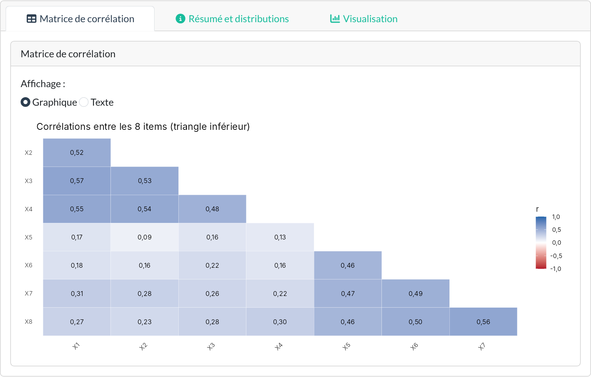
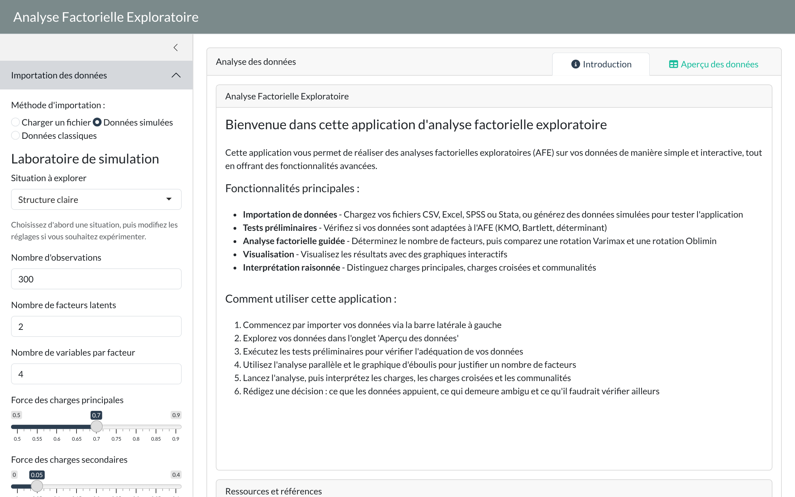

# Comprendre ce que cherche une AFE {#sec-comprendre}

```{r}
#| include: false
source("_common.R")
R <- cor(fil)
L <- fil_pop$loadings
phi <- matrix(c(1, .30, .30, 1), 2)
implicite <- L %*% phi %*% t(L); diag(implicite) <- 1
moy_intra1 <- mean(R[1:4, 1:4][upper.tri(diag(4))])
moy_intra2 <- mean(R[5:8, 5:8][upper.tri(diag(4))])
moy_inter <- mean(R[1:4, 5:8])
acp <- suppressMessages(psych::principal(fil, 2, rotate = "oblimin"))
L_acp <- unclass(acp$loadings)
```

::: {.callout-note appearance="simple" title="Dans ce chapitre"}
- écrire le modèle factoriel commun et lire chacun de ses termes;
- comprendre comment des facteurs **expliquent des corrélations**;
- décomposer la variance d’un item en communalité et unicité;
- distinguer l’AFE de l’analyse en composantes principales (ACP);
- connaître les quatre situations du laboratoire de simEFA.
:::

> **Idée centrale.** Si plusieurs items se ressemblent, c’est peut-être parce qu’ils dépendent d’une même cause commune. L’AFE part des corrélations entre items et cherche le plus petit nombre de facteurs capables de les reproduire.

L’analyse factorielle exploratoire cherche une structure dans les **corrélations** entre variables. Elle devient pertinente lorsque plusieurs items sont supposés mesurer quelques attributs non observés directement : anxiété, sentiment d’efficacité, soutien social, compréhension d’un concept ou attitudes politiques.

## Items observés, facteurs latents

Un item $X_j$ standardisé peut être décrit, de façon simplifiée, par :

$$
X_j = \lambda_{j1}F_1 + \lambda_{j2}F_2 + \cdots + \lambda_{jq}F_q + e_j.
$$ {#eq-modele}

Les $F$ sont les facteurs communs, les $\lambda$ sont les **charges factorielles** et $e_j$ représente ce qui est propre à l’item : erreur de mesure, formulation, contenu particulier ou causes non incluses dans le modèle. On suppose que les facteurs communs ne sont pas corrélés avec les parties propres, et que les parties propres de deux items différents ne sont pas corrélées entre elles. L’AFE estime une structure compatible avec la matrice de corrélation; elle ne mesure pas directement un facteur « vrai » dans chaque personne.

```{r}
#| label: fig-diagramme
#| fig-cap: "Le modèle du cas fil rouge. Deux facteurs latents (ellipses) corrélés à 0,30 causent chacun quatre items (rectangles). Chaque flèche porte une charge de 0,70; les petites charges secondaires de 0,05 ne sont pas dessinées. Chaque item reçoit aussi une partie propre e."
#| fig-height: 3.4
items <- data.frame(x = c(1:4, 6:9), y = 0, nom = paste0("X", 1:8))
fact <- data.frame(x = c(2.5, 7.5), y = 2, nom = c("F1", "F2"))
fleches <- data.frame(x = rep(fact$x, each = 4), y = 1.72, xend = items$x, yend = 0.32)
ggplot() +
  geom_segment(data = fleches, aes(x, y, xend = xend, yend = yend),
               arrow = arrow(length = unit(0.16, "cm")), colour = pal$bleu, linewidth = 0.7) +
  geom_curve(aes(x = 2.9, y = 2.32, xend = 7.1, yend = 2.32), curvature = -0.25,
             arrow = arrow(ends = "both", length = unit(0.14, "cm")), colour = pal$orange) +
  annotate("text", x = 5, y = 2.78, label = "corrélation 0,30", colour = pal$orange, size = 3.6) +
  annotate("text", x = 1.55, y = 1.15, label = "0,70", colour = pal$bleu, size = 3.3) +
  geom_tile(data = items, aes(x, y), width = 0.8, height = 0.55, fill = "white", colour = "black") +
  geom_text(data = items, aes(x, y, label = nom), size = 3.8) +
  geom_point(data = fact, aes(x, y), shape = 21, size = 19, fill = "#eaf2fb", colour = pal$bleu) +
  geom_text(data = fact, aes(x, y, label = nom), size = 4.5, fontface = "bold") +
  geom_segment(data = items, aes(x = x, y = -0.75, xend = x, yend = -0.3),
               arrow = arrow(length = unit(0.12, "cm")), colour = "grey50") +
  geom_text(data = items, aes(x = x, y = -0.92, label = "e"), colour = "grey40", size = 3.4) +
  coord_cartesian(xlim = c(0.4, 9.6), ylim = c(-1.05, 3)) + theme_void()
```

### Des facteurs qui expliquent des corrélations

Le modèle a une conséquence simple et puissante. Avec un seul facteur et des items standardisés, la corrélation entre deux items est le **produit de leurs charges** : $r_{jk}=\lambda_j\lambda_k$. Avec deux facteurs corrélés à $\phi$, deux items qui dépendent chacun d’un facteur différent sont corrélés à $\lambda_j\,\phi\,\lambda_k$.

::: {.callout-note title="Cas fil rouge"}
Dans la population du cas fil rouge, deux items du même facteur devraient être corrélés à environ $0{,}70\times0{,}70=0{,}49$, et deux items de facteurs différents à $0{,}70\times0{,}30\times0{,}70\approx0{,}15$ (un peu plus lorsque l’un d’eux porte une petite charge secondaire). Dans l’échantillon de 300 personnes, les corrélations moyennes valent `r fr(moy_intra1)` parmi X1 à X4, `r fr(moy_intra2)` parmi X5 à X8 et `r fr(moy_inter)` entre les deux blocs. Le modèle ne reproduit pas chaque corrélation exactement (l’échantillon fluctue), mais il en explique le **patron** : deux blocs d’items fortement liés, faiblement liés entre eux.
:::

L’AFE fait le chemin inverse : à partir des corrélations observées, elle cherche des charges et des corrélations entre facteurs qui les reproduisent au mieux. Les corrélations que le modèle ne reproduit pas sont des **résidus**; de petits résidus indiquent que le nombre de facteurs suffit.

### Communalité et unicité

Pour un item standardisé, la variance totale vaut 1. Elle se partage en deux :

- la **communalité** $h^2_j$, la part que l’item partage avec les autres à travers les facteurs communs. Avec des facteurs non corrélés, $h^2_j=\sum_k\lambda_{jk}^2$;
- l’**unicité** $\psi_j=1-h^2_j$, la part propre à l’item (sa spécificité et son erreur de mesure).

Un item de charge 0,70 sur un seul facteur a une communalité de $0{,}70^2=0{,}49$ : un peu moins de la moitié de sa variance est commune. Le reste ne concerne que lui. C’est une situation très ordinaire pour un item de questionnaire.

```{r}
#| label: fig-variance-item
#| fig-cap: "Décomposition de la variance de quatre items types. La partie colorée est la communalité h² (variance partagée avec les autres items via les facteurs), la partie grise l'unicité ψ = 1 − h²."
#| fig-height: 2.6
ex <- data.frame(item = factor(c("Charge 0,90", "Charge 0,70", "Charge 0,50", "Charge 0,30"),
                               levels = rev(c("Charge 0,90", "Charge 0,70", "Charge 0,50", "Charge 0,30"))),
                 h2 = c(.81, .49, .25, .09))
d <- rbind(data.frame(item = ex$item, part = "Communalité h²", v = ex$h2),
           data.frame(item = ex$item, part = "Unicité ψ", v = 1 - ex$h2))
d$part <- factor(d$part, levels = c("Unicité ψ", "Communalité h²"))
ggplot(d, aes(v, item, fill = part)) +
  geom_col(width = 0.65) +
  geom_text(data = ex, aes(x = h2 / 2, y = item, label = fr(h2)), inherit.aes = FALSE, colour = "white", size = 3.4) +
  scale_fill_manual(values = c("Unicité ψ" = "grey80", "Communalité h²" = pal$bleu), name = NULL) +
  scale_x_continuous(labels = axe_fr, breaks = seq(0, 1, .25)) +
  labs(x = "Part de la variance de l'item", y = NULL)
```

::: {.callout-tip title="Dans simEFA"}
Choisissez **Données simulées**, la situation **Structure claire**, puis cliquez sur **Générer**. Observez la matrice de corrélation dans **Aperçu des données ▸ Statistiques descriptives ▸ Matrice de corrélation**. Les corrélations sont le matériau de départ de toute l’analyse.
:::

{#fig-cap-correlation .capture}

## Une AFE n’est pas une ACP

L’analyse en composantes principales (ACP) résume la variance **totale** de variables observées. L’AFE cherche plutôt à séparer la variance **commune** de la variance propre. Les deux méthodes peuvent parfois livrer des tableaux qui se ressemblent, mais elles répondent à des questions différentes.

| Question | ACP | AFE |
|:--|:--|:--|
| But central | Résumer des variables | Modéliser leur variance commune |
| Objet obtenu | Composantes (combinaisons des items) | Facteurs latents hypothétiques (causes des items) |
| Variance propre et erreur | Conservées dans la composante | Distinguées de la variance commune |
| Diagonale analysée | 1 (variance totale) | Communalités (variance commune) |
| Usage typique | Réduction descriptive | Élaboration ou étude d’une échelle |

: ACP et AFE. {#tbl-acp-afe}

La différence n’est pas qu’affaire de vocabulaire. Comme l’ACP intègre la variance propre de chaque item dans les composantes, ses « charges » sont systématiquement **plus fortes** que les charges factorielles, et d’autant plus que les items sont peu fiables.

```{r}
#| label: fig-acp-afe
#| fig-cap: "Cas fil rouge : charge principale de chaque item selon l'ACP et selon l'AFE (rotation oblique dans les deux cas). La ligne pointillée marque la charge de population, 0,70. L'ACP surestime systématiquement les charges, parce qu'elle attribue aux composantes une part de la variance propre des items."
#| fig-height: 3.2
prim <- function(M) apply(M, 1, function(r) r[which.max(abs(r))])
dd <- data.frame(item = rep(rownames(fil_afe$loadings), 2),
                 methode = rep(c("ACP", "AFE (ML)"), each = 8),
                 charge = c(prim(L_acp), prim(fil_afe$loadings)))
dd$item <- factor(dd$item, levels = paste0("X", 1:8))
ggplot(dd, aes(item, charge, fill = methode)) +
  geom_col(position = position_dodge(0.7), width = 0.65) +
  geom_hline(yintercept = 0.70, linetype = 2) +
  scale_fill_manual(values = c(ACP = pal$orange, "AFE (ML)" = pal$bleu), name = NULL) +
  scale_y_continuous(labels = axe_fr, limits = c(0, 1)) +
  labs(x = NULL, y = "Charge principale")
```

Dans le cas fil rouge, les charges principales de l’ACP vont de `r fr(min(abs(prim(L_acp))))` à `r fr(max(abs(prim(L_acp))))`, celles de l’AFE de `r fr(min(abs(prim(fil_afe$loadings))))` à `r fr(max(abs(prim(fil_afe$loadings))))`, pour une valeur de population de 0,70 (@fig-acp-afe). Dans ce manuel, lorsque l’objectif est de comprendre des construits et des items, le mot *facteur* désigne une analyse factorielle, non une composante principale.

## L’AFE est exploratoire, pas athéorique

« Exploratoire » ne veut pas dire que toute solution statistiquement possible se vaut. Avant l’analyse, il faut savoir ce que chaque item prétend mesurer, quels facteurs sont plausibles et quelles relations entre eux seraient raisonnables. Après l’analyse, la lecture du contenu des items est indispensable pour nommer les facteurs.

« Exploratoire » signifie autre chose : le modèle laisse **chaque item charger sur chaque facteur**. On ne précise pas d’avance quels items appartiennent à quel facteur; c’est ce que l’analyse propose. L’analyse factorielle confirmatoire (chapitre [-@sec-cfa]) fera le contraire : elle fixera à zéro les charges que la théorie juge absentes, puis vérifiera si les données le permettent.

Une AFE peut suggérer qu’un item est ambigu. Elle ne peut pas décider seule si l’item doit être retiré : une charge croisée peut refléter un mauvais item, mais aussi deux construits réellement liés, une formulation très générale ou un échantillon particulier.

## Les quatre situations du laboratoire

Le laboratoire de simulation de simEFA ne fournit pas seulement des exemples « parfaits ». Il permet de créer des difficultés courantes. Chaque situation est un jeu de réglages que l’on peut ensuite modifier.

| Situation | Réglages de départ | Ce que l’on observe souvent | Question pédagogique |
|:--|:--|:--|:--|
| Structure claire | 300 cas, 2 × 4 items, charges 0,70, φ = 0,30 | Charges principales nettes | Peut-on retrouver les facteurs générateurs? |
| Facteurs corrélés | 300 cas, 2 × 4 items, charges 0,65, φ = 0,55 | Structure oblique plausible | Une rotation orthogonale déforme-t-elle la lecture? |
| Items ambigus | 300 cas, 2 × 4 items, charges 0,60, charges secondaires 0,30 pour la moitié des items | Charges secondaires notables | Que signifie une structure non simple? |
| Petit échantillon / structure fragile | 100 cas, 3 × 3 items, charges 0,50 | Résultats plus instables | Qu’est-ce qu’un échantillon peut réellement soutenir? |

: Les quatre situations du laboratoire de simulation. {#tbl-situations}

Changez une seule option à la fois. Cette discipline est plus instructive que de modifier tous les réglages jusqu’à obtenir le tableau désiré.

Les charges secondaires ne sont pas nécessairement appliquées à tous les items. Le réglage **Proportion d’items ambigus** permet de rendre seulement certains items hybrides, comme cela arrive plus souvent dans un questionnaire réel. Une graine identique reproduit non seulement les personnes simulées, mais aussi ce patron d’items ambigus. L’onglet **Aperçu des données ▸ Population simulée** affiche les charges vraies : vous saurez toujours quels items ont été rendus ambigus.

::: {.callout-note title="Le multiplicateur de bruit"}
Le réglage **Multiplicateur du bruit résiduel** vaut 1 par défaut : les charges standardisées de population sont alors exactement celles des curseurs. Sous 1, la partie propre de chaque item est réduite; les items deviennent plus fiables et leurs charges standardisées **plus fortes** que la valeur du curseur. L’onglet **Population simulée** affiche toujours les charges standardisées réellement en vigueur.
:::

::: {.callout-warning title="Piège classique"}
Ne confondez pas une structure reproduite dans une simulation et la preuve qu’une structure existera dans des données réelles. La simulation sert à rendre visibles les mécanismes; elle ne remplace ni l’échantillonnage ni la validité du contenu des items.
:::

## Dans simEFA

{#fig-cap-interface .capture}

::: {.callout-tip title="Dans simEFA"}
Au démarrage (@fig-cap-interface), cliquez sur **Générer** sans changer les réglages : vous obtenez le cas fil rouge (graine 1234). Ouvrez **Aperçu des données ▸ Population simulée** : le tableau donne les charges vraies. Les items X1, X7 et X8 portent une petite charge secondaire de 0,05; c’est le tirage des items ambigus, fixé par la graine.
:::

## Laboratoire

::: {.callout-tip title="Dans simEFA"}
À partir du cas fil rouge, faites passer **Force des charges principales** de 0,70 à 0,50 (même graine), puis cliquez sur **Générer**. Avant de regarder, calculez la corrélation attendue entre deux items d’un même facteur et la communalité de ces items. Vérifiez ensuite dans la matrice de corrélation.
:::

::: {.callout-note collapse="true" title="Réponse"}
```{r}
#| include: false
f50 <- simuler("clear", main = .50); R50 <- cor(f50)
m50 <- mean(c(R50[1:4, 1:4][upper.tri(diag(4))], R50[5:8, 5:8][upper.tri(diag(4))]))
```
La corrélation attendue entre deux items d’un même facteur est $0{,}50\times0{,}50=0{,}25$, et la communalité de chaque item vaut 0,25 : les trois quarts de sa variance sont propres. Dans l’échantillon, les corrélations à l’intérieur des blocs valent en moyenne `r fr(m50)`. Les deux blocs restent visibles, mais beaucoup moins contrastés : avec des charges plus faibles, il faut davantage de données pour retrouver la structure, ce que le chapitre [-@sec-facteurs] mesurera.
:::

## À retenir

- Le modèle factoriel décrit chaque item comme une somme de facteurs communs pondérés par des charges, plus une partie propre.
- Les facteurs **expliquent les corrélations** : deux items corrèlent parce qu’ils partagent des facteurs ($r_{jk}=\lambda_j\lambda_k$ avec un seul facteur).
- La variance d’un item se partage en communalité (commune) et unicité (propre).
- L’ACP résume la variance totale; l’AFE modélise la variance commune. Les charges d’ACP sont gonflées par la variance propre.
- Exploratoire veut dire « chaque item peut charger sur chaque facteur », pas « sans théorie ».

## Quiz

1. Un item a une charge de 0,60 sur un seul facteur. Que valent sa communalité et son unicité?
2. Deux items chargent à 0,80 et 0,50 sur le même facteur, et sur aucun autre. Quelle corrélation le modèle prévoit-il entre eux?
3. Pourquoi les charges d’une ACP sont-elles plus élevées que celles d’une AFE sur les mêmes données?
4. Que fixe une analyse confirmatoire qu’une analyse exploratoire laisse libre?
5. Dans simEFA, où peut-on voir les charges vraies d’une simulation?

::: {.callout-note collapse="true" title="Réponses du quiz"}
1. $h^2=0{,}36$ et $\psi=0{,}64$.
2. $0{,}80\times0{,}50=0{,}40$.
3. L’ACP analyse la variance totale (1 sur la diagonale) : la variance propre des items s’ajoute aux composantes.
4. Les charges que la théorie juge absentes, fixées à 0.
5. Dans **Aperçu des données ▸ Population simulée**.
:::
