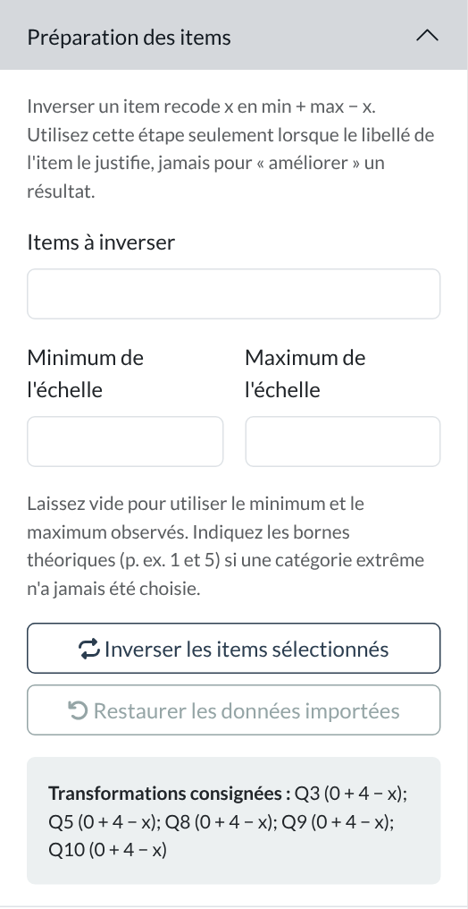
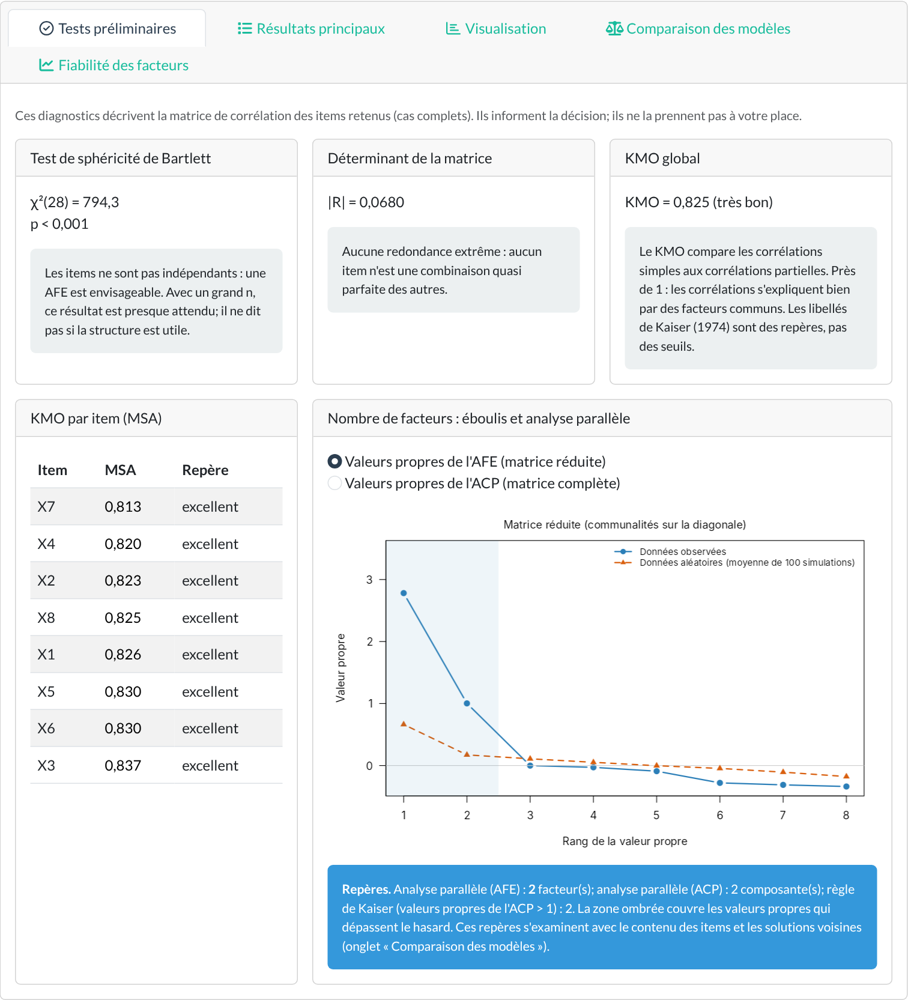

# Préparer et examiner les données {#sec-preparer}

```{r}
#| include: false
source("_common.R")
# Certains postes ont une version antérieure de EFA.dimensions, qui ne fournit
# pas encore `data_RSE_not_recoded`. Dans ce cas, on recrée ces données à partir
# de `data_RSE`, qui est le même jeu déjà recodé.
get_efa_data <- function(nom) {
  e <- new.env(parent = emptyenv())
  suppressWarnings(utils::data(list = nom, package = "EFA.dimensions", envir = e))
  if (exists(nom, envir = e, inherits = FALSE)) get(nom, envir = e, inherits = FALSE) else NULL
}
inv <- c("Q1", "Q2", "Q4", "Q6", "Q7")
rse <- get_efa_data("data_RSE_not_recoded")
if (is.null(rse)) {
  rse <- get_efa_data("data_RSE")
  if (is.null(rse)) {
    stop("Le chapitre requiert le jeu data_RSE du package EFA.dimensions. Mettez ce package à jour, puis relancez la compilation.")
  }
  rse <- as.data.frame(rse)
  rse[inv] <- 4 - rse[inv]  # recrée les cinq items non inversés
}
rse <- as.data.frame(rse)   # `psych::alpha()` exige un data.frame ou une matrice
rse[] <- lapply(rse, as.numeric)
rse_r <- rse; rse_r[inv] <- 4 - rse_r[inv]
n_rse <- nrow(rse)
alpha_avant <- psych::alpha(rse, check.keys = FALSE, warnings = FALSE)$total$raw_alpha
alpha_apres <- psych::alpha(rse_r, check.keys = FALSE, warnings = FALSE)$total$raw_alpha
R_fil <- cor(fil)
bart <- psych::cortest.bartlett(R_fil, n = nrow(fil))
kmo <- psych::KMO(R_fil)
data(bfi, package = "psych"); b25 <- bfi[, 1:25]
n_complet <- sum(complete.cases(b25))
```

::: {.callout-note appearance="simple" title="Dans ce chapitre"}
- sélectionner des items qui répondent à une même question de mesure;
- inverser les items formulés à l’envers, pour une raison de contenu;
- repérer les valeurs manquantes et ce que l’analyse des cas complets retire;
- lire la matrice de corrélation, le déterminant, Bartlett et le KMO comme des **indicateurs**;
- savoir quand des items Likert justifient une analyse polychorique.
:::

> **Idée centrale.** L’AFE ne voit que la matrice de corrélation. Tout ce qui déforme cette matrice (un item mal orienté, un sous-groupe, des cas exclus, une redondance) déforme la solution. Préparer les données, c’est s’assurer que la matrice raconte la bonne histoire.

Avant de choisir une extraction ou une rotation, il faut vérifier que les données représentent bien les variables que l’on veut analyser. Dans simEFA, cette étape se déroule dans la barre latérale (**Importation des données**, **Filtrage des données**, **Préparation des items**) et dans l’onglet **Aperçu des données**.

## Importer et sélectionner avec intention

L’application lit les formats CSV, Excel, SPSS et Stata. Après l’importation, utilisez **Paramètres de l’analyse ▸ Variables à inclure** pour sélectionner uniquement les variables qui répondent à une même question de mesure. Ne placez pas dans la même AFE des variables démographiques, une conséquence et des items d’échelle simplement parce qu’elles sont disponibles.

Un filtre (**Filtrage des données**) peut être utile pour examiner une population définie, mais il modifie la matrice de corrélation. Une solution obtenue chez un sous-groupe ne décrit pas automatiquement l’échantillon entier; signalez clairement le groupe filtré dans tout compte rendu. Dans simEFA, appliquer ou retirer un filtre efface la solution affichée : elle ne correspond plus aux données.

## Préparer les items avant l’AFE

L’accordéon **Préparation des items** permet d’inverser des items numériques lorsque leur libellé le justifie. L’opération appliquée est explicite : si l’échelle va de $a$ à $b$, la réponse devient $a+b-x$. Par défaut, $a$ et $b$ sont le minimum et le maximum observés; si une catégorie extrême n’a jamais été choisie, inscrivez les bornes théoriques de l’échelle (par exemple 1 et 5) dans les deux cases prévues. L’application conserve une trace de chaque transformation et permet de restaurer les données originales.

::: {.callout-note title="Exemple réel : l'échelle d'estime de soi de Rosenberg"}
Le jeu **Estime de soi de Rosenberg : items négatifs NON recodés** (**Données classiques**) contient les dix items de l’échelle, notés de 0 à 4, chez `r format(n_rse, big.mark = " ")` personnes. Cinq items sont formulés négativement (Q1, Q2, Q4, Q6 et Q7, du type « J’ai parfois l’impression de n’être bon à rien ») et n’ont pas été inversés. Leurs corrélations avec les items positifs sont donc négatives (@fig-rse).
:::

```{r}
#| label: fig-rse
#| fig-cap: "Échelle de Rosenberg : corrélations entre les dix items avant (à gauche) et après (à droite) l'inversion des items Q1, Q2, Q4, Q6 et Q7. Avant, deux blocs s'opposent en rouge; après, tous les items mesurent l'estime de soi dans le même sens."
#| fig-height: 3.6
heat <- function(R, titre) {
  v <- colnames(R); n <- length(v)
  d <- expand.grid(i = seq_len(n), j = seq_len(n)); d$r <- R[cbind(d$i, d$j)]
  d <- d[d$i > d$j, ]; d$x <- factor(v[d$j], levels = v); d$y <- factor(v[d$i], levels = rev(v))
  d$titre <- titre; d
}
dd <- rbind(heat(cor(rse), "Avant l'inversion"), heat(cor(rse_r), "Après l'inversion"))
dd$titre <- factor(dd$titre, levels = c("Avant l'inversion", "Après l'inversion"))
ggplot(dd, aes(x, y, fill = r)) +
  geom_tile(colour = "white") +
  facet_wrap(~titre) +
  scale_fill_gradient2(low = "#b2182b", mid = "white", high = "#2166ac", limits = c(-1, 1),
                       labels = axe_fr, name = "r") +
  labs(x = NULL, y = NULL) +
  theme(panel.grid = element_blank(), axis.text.x = element_text(angle = 90, vjust = 0.5, size = 8),
        axis.text.y = element_text(size = 8), legend.position = "right")
```

Les conséquences d’un oubli sont spectaculaires. Avant l’inversion, l’alpha de Cronbach des dix items vaut `r fr(alpha_avant, 2)` : un nombre qui n’a aucun sens, car les items positifs et négatifs s’annulent dans la somme. Après l’inversion, il vaut `r fr(alpha_apres, 2)`. Une AFE à un facteur, elle, retrouve des charges de même ampleur dans les deux cas, mais de signes opposés avant l’inversion : le facteur est le même, seule l’orientation des items diffère.

Ne choisissez jamais les items à inverser parce qu’ils « améliorent » les résultats. La décision vient du libellé, du codebook ou de la théorie. Après toute inversion, relisez la matrice de corrélation : des relations auparavant négatives doivent devenir cohérentes avec les autres items de l’échelle.

{#fig-cap-preparation .capture width="55%"}

### Les valeurs manquantes

L’encadré **Valeurs manquantes** (**Aperçu des données ▸ Statistiques descriptives ▸ Résumé et distributions**) indique, pour chaque variable sélectionnée, le nombre et le pourcentage de valeurs absentes. L’AFE de simEFA repose sur les **cas complets** pour les items inclus : une personne qui a omis un seul item est retirée de toute l’analyse.

::: {.callout-note title="Exemple réel : le BFI"}
Le jeu **BFI : 25 items de personnalité** compte 2 800 personnes. Aucun item ne manque chez plus de 1,3 % des répondants, mais les omissions ne touchent pas les mêmes personnes : seules `r format(n_complet, big.mark = " ")` personnes ont répondu aux 25 items. L’analyse porte donc sur `r pc(n_complet / 2800)` de l’échantillon. La **Lecture guidée de la solution** rappelle ce chiffre après chaque AFE.
:::

Comparez donc toujours le nombre d’observations initial au nombre réellement analysé. Une exclusion importante peut modifier la population décrite, surtout si les personnes qui omettent des items diffèrent des autres.

## Observer avant de calculer

Dans **Résumé et distributions**, le tableau descriptif donne pour chaque variable l’effectif, la moyenne, l’écart-type, le minimum, le maximum, le nombre de valeurs distinctes, l’asymétrie et l’aplatissement. Examinez :

- son type et son étendue plausible (un maximum de 9 sur une échelle de 1 à 5 signale un code de valeur manquante);
- ses valeurs manquantes et ses catégories très rares;
- son asymétrie et d’éventuelles valeurs aberrantes;
- son nombre de valeurs distinctes : 5 ou 7 valeurs signalent un item Likert;
- son contenu : une inversion mal codée crée facilement des corrélations inattendues.

Un test de normalité significatif est fréquent dans un grand échantillon et ne décide pas à lui seul si une AFE est possible. Inversement, l’absence de significativité ne garantit rien. Les graphiques (**Visualisation**) et la nature des items sont plus informatifs qu’un verdict automatique.

## La matrice de corrélation

Une AFE a besoin de corrélations ni toutes nulles, ni presque parfaitement redondantes. Dans l’onglet de matrice, recherchez des regroupements cohérents plutôt qu’une mer uniforme de petites corrélations. Dans le cas fil rouge (@fig-cap-correlation), deux blocs se détachent nettement.

Le **déterminant** de la matrice résume un risque particulier. Il vaut 1 lorsque tous les items sont indépendants et tend vers 0 lorsque certains items deviennent des combinaisons quasi exactes des autres. Une valeur très proche de zéro (moins de 0,00001) signale une multicolinéarité excessive : deux items pratiquement identiques n’apportent pas deux indications indépendantes d’un construit et peuvent rendre l’estimation instable.

## KMO et Bartlett : des indicateurs, non des permissions

{#fig-cap-prelim .capture}

Dans **Analyse factorielle ▸ Tests préliminaires**, simEFA affiche trois diagnostics classiques (@fig-cap-prelim).

Le **test de Bartlett** examine l’hypothèse d’une matrice de corrélation identité (aucune corrélation dans la population). Un résultat significatif indique qu’il existe des corrélations; avec un grand $n$, ce résultat est presque attendu et ne dit pas si la structure est utile. Pour le cas fil rouge, $\chi^2(`r bart$df`)=`r frm(bart$chisq, 1)`$, $p<0{,}001$ : il fallait s’y attendre avec des corrélations de 0,5.

L’**indice KMO** (Kaiser-Meyer-Olkin) compare les corrélations simples aux corrélations **partielles**. Si des facteurs communs expliquent les liens entre items, la corrélation entre deux items doit presque disparaître lorsqu’on contrôle tous les autres : les corrélations partielles sont petites et le KMO s’approche de 1. Pour le cas fil rouge, KMO = `r fr(kmo$MSA, 3)`.

$$\mathrm{KMO}=\frac{\sum_{j\neq k} r_{jk}^2}{\sum_{j\neq k} r_{jk}^2+\sum_{j\neq k} a_{jk}^2},$$

où $a_{jk}$ est la corrélation partielle entre les items $j$ et $k$. Les repères usuels (autour de 0,60 comme minimum prudent, 0,70 ou 0,80 comme plus rassurants) restent des aides de lecture, pas une frontière scientifique universelle [@kaiser1974]. Les **KMO individuels** (MSA) appliquent la même formule à un seul item : ils peuvent révéler un item qui s’intègre mal à l’ensemble. Le tableau les trie du plus faible au plus fort.

::: {.callout-tip title="Activité"}
Générez une **Structure claire**, puis passez au scénario **Petit échantillon / structure fragile**. Sans changer d’autres réglages, comparez KMO, déterminant et matrice de corrélation. Quels résultats semblent devenir moins stables? Lesquels demeurent seulement descriptifs?
:::

## Items Likert et corrélations

Les réponses Likert sont ordinales. Lorsque les catégories sont nombreuses (cinq ou plus) et raisonnablement occupées, l’analyse sur corrélations de Pearson peut servir d’approximation. Lorsque les items sont très asymétriques, présentent peu de catégories ou sont fortement plafonnés, les corrélations de Pearson sont **atténuées** et une AFE sur corrélations polychoriques peut être plus cohérente avec leur nature ordinale. Ce choix constitue une analyse distincte : il ne se résume pas à exécuter un test de normalité ou à choisir une extraction robuste [@flora2004].

Dans **Paramètres de l’analyse**, indiquez la nature approximative des items. Ce choix rend visible une limite importante : simEFA réalise l’AFE sur corrélations de Pearson, même lorsque vous signalez des items ordinaux. Dans ce cas, interprétez l’analyse comme une approximation et documentez la nécessité éventuelle d’une analyse polychorique/WLSMV complémentaire.

::: {.callout-important title="À documenter"}
Un rapport reproductible indique les variables retenues, les recodages, la gestion des valeurs manquantes, le sous-groupe éventuel, la matrice de corrélation utilisée et la raison de ces choix.
:::

## Laboratoire

::: {.callout-tip title="Dans simEFA"}
Chargez **Estime de soi de Rosenberg : items négatifs NON recodés**. Dans la matrice de corrélation, repérez les items formulés à l’envers. Inversez-les dans **Préparation des items**, puis comparez la matrice et le KMO avant et après.
:::

::: {.callout-note collapse="true" title="Réponse"}
```{r}
#| include: false
kmo_av <- psych::KMO(cor(rse))$MSA; kmo_ap <- psych::KMO(cor(rse_r))$MSA
```
Les items Q1, Q2, Q4, Q6 et Q7 sont corrélés négativement avec les cinq autres et positivement entre eux : ce sont les items à inverser (leur libellé le confirme). Après l’inversion, toutes les corrélations sont positives (@fig-rse). Le KMO, lui, ne change pas (`r fr(kmo_av, 3)` avant comme après) : il repose sur des corrélations au carré, insensibles au signe. C’est une bonne leçon : un diagnostic de factorabilité ne détecte pas un item mal orienté; seule la lecture de la matrice (et des libellés) le fait.
:::

## À retenir

- L’AFE n’analyse que la matrice de corrélation : sélection, filtre, recodage et cas exclus la modifient.
- On inverse un item pour une raison de contenu, jamais pour améliorer un indice.
- L’analyse des cas complets peut retirer une part importante de l’échantillon : comparez toujours *n* initial et *n* analysé.
- Bartlett, déterminant et KMO sont des indicateurs de factorabilité, pas des permis.
- Des items Likert peu catégorisés ou très asymétriques appellent une analyse polychorique, à documenter.

## Quiz

1. Une échelle va de 1 à 5. Que devient la réponse 2 après inversion?
2. Le test de Bartlett est significatif avec $n=1\,500$. Peut-on conclure que la structure factorielle est utile?
3. Que signifie un KMO proche de 1?
4. Pourquoi le KMO ne détecte-t-il pas un item non inversé?
5. Une enquête compte 1 000 répondants; 15 % ont omis au moins un des 20 items. Combien de cas l’AFE analysera-t-elle?

::: {.callout-note collapse="true" title="Réponses du quiz"}
1. $1+5-2=4$.
2. Non. Il indique seulement que la matrice n’est pas une identité, ce qui est presque garanti avec un grand échantillon.
3. Que les corrélations partielles sont petites : les corrélations entre items s’expliquent bien par des facteurs communs.
4. Parce qu’il utilise des corrélations au carré : le signe disparaît.
5. Environ 850 : seuls les cas complets sont retenus.
:::
