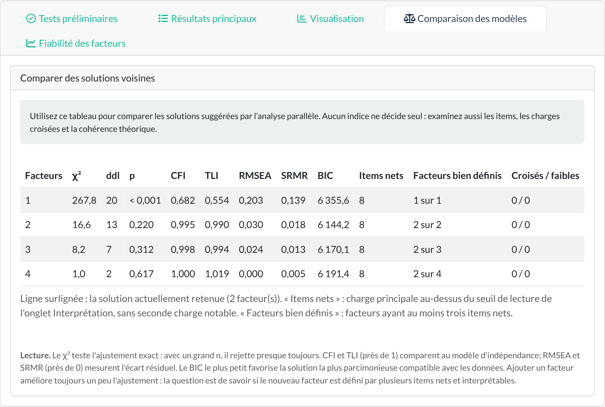

# Décider du nombre de facteurs {#sec-facteurs}

```{r}
#| include: false
source("_common.R")
pa_fil <- parallele(fil)
frag <- simuler("fragile"); pa_frag <- parallele(frag)
e <- new.env(); data(list = "data_RSE_not_recoded", package = "EFA.dimensions", envir = e)
rse_r <- e$data_RSE_not_recoded; inv <- c("Q3", "Q5", "Q8", "Q9", "Q10"); rse_r[inv] <- 4 - rse_r[inv]
pa_rse <- parallele(rse_r)
rse2 <- suppressWarnings(ajuster_afe(rse_r, 2, "oblimin", "ML"))
rse1 <- suppressWarnings(ajuster_afe(rse_r, 1, "oblimin", "ML"))
voisines <- lapply(1:4, function(q) suppressWarnings(ajuster_afe(fil, q, "oblimin", "ML")))
fit <- sapply(voisines, function(s) s$fit_indices[c("chisq", "df", "pvalue", "cfi", "tli", "rmsea", "srmr", "bic")])
```

::: {.callout-note appearance="simple" title="Dans ce chapitre"}
- comprendre ce qu’est une valeur propre et pourquoi on en compare la grandeur;
- lire un éboulis et une analyse parallèle;
- savoir pourquoi la règle de Kaiser n’est pas un critère de décision;
- comparer des solutions voisines par leur ajustement **et** leur lisibilité;
- reconnaître un facteur de méthode et la fragilité d’une décision avec un petit échantillon.
:::

> **Idée centrale.** Ajouter un facteur améliore toujours un peu la reproduction des corrélations. La question n’est donc pas « le facteur suivant explique-t-il quelque chose? », mais « explique-t-il plus que ce que le hasard expliquerait, et correspond-il à un contenu interprétable? ».

Le nombre de facteurs ne se lit pas dans une seule cellule. Cette décision combine une attente théorique, les valeurs propres, l’analyse parallèle, l’éboulis, la clarté de la structure et la possibilité d’interpréter chaque facteur avec des items suffisamment nombreux et cohérents.

## Ce que mesure une valeur propre

Une matrice de corrélation de $p$ items peut être décomposée en $p$ dimensions orthogonales, ordonnées de la plus importante à la moins importante. La **valeur propre** d’une dimension mesure la quantité de variance qu’elle résume. Deux variantes coexistent :

- avec la **matrice complète** (des 1 sur la diagonale, comme en ACP), les $p$ valeurs propres totalisent $p$; une valeur propre de 3,4 sur 8 items résume l’équivalent de 3,4 items;
- avec la **matrice réduite** (les communalités estimées sur la diagonale, comme en AFE), seule la variance commune est décomposée; les valeurs propres sont plus petites et peuvent devenir négatives au-delà des vrais facteurs.

Si les items étaient tous indépendants, chaque valeur propre de la matrice complète vaudrait exactement 1. Une structure factorielle se manifeste par quelques valeurs propres nettement plus grandes que les autres.

## L’analyse parallèle : le point de départ recommandé

L’analyse parallèle compare les valeurs propres observées à celles qui apparaîtraient dans des jeux de données aléatoires de même taille (même nombre de personnes et d’items, mais sans aucun facteur commun). Un facteur est retenu lorsque la valeur propre observée est plus grande que celle attendue par hasard. Cette méthode protège mieux que la règle « valeur propre supérieure à 1 », qui tend à retenir trop de facteurs [@horn1965; @zwick1986].

```{r}
#| label: fig-parallele
#| fig-cap: "Éboulis et analyse parallèle (matrice réduite, comme dans simEFA). Points bleus : valeurs propres observées; triangles orange : moyenne de 100 jeux de données aléatoires de même taille. La zone ombrée couvre les facteurs dont la valeur propre dépasse le hasard. À gauche, le cas fil rouge; à droite, la situation fragile (100 personnes, 3 × 3 items, charges 0,50)."
#| fig-height: 3.4
dd <- rbind(
  data.frame(cas = "Cas fil rouge (2 facteurs vrais)", k = seq_along(pa_fil$fa_obs),
             obs = pa_fil$fa_obs, sim = pa_fil$fa_sim, sugg = pa_fil$sugg_fa),
  data.frame(cas = "Situation fragile (3 facteurs vrais)", k = seq_along(pa_frag$fa_obs),
             obs = pa_frag$fa_obs, sim = pa_frag$fa_sim, sugg = pa_frag$sugg_fa))
zones <- unique(dd[, c("cas", "sugg")])
ggplot(dd, aes(k)) +
  geom_rect(data = zones, aes(xmin = 0.5, xmax = sugg + 0.5, ymin = -Inf, ymax = Inf),
            inherit.aes = FALSE, fill = pal$bleu, alpha = 0.08) +
  geom_hline(yintercept = 0, colour = "grey70") +
  geom_line(aes(y = obs), colour = pal$bleu, linewidth = 0.9) + geom_point(aes(y = obs), colour = pal$bleu, size = 2.2) +
  geom_line(aes(y = sim), colour = pal$orange, linetype = 2, linewidth = 0.9) +
  geom_point(aes(y = sim), colour = pal$orange, shape = 17, size = 2.2) +
  facet_wrap(~cas, scales = "free_x") +
  scale_x_continuous(breaks = 1:9) + scale_y_continuous(labels = axe_fr) +
  labs(x = "Rang de la valeur propre", y = "Valeur propre (matrice réduite)")
```

Dans simEFA, le graphique de l’analyse parallèle apparaît dans **Analyse factorielle ▸ Tests préliminaires** (@fig-cap-prelim). La courbe observée représente la structure des données; la courbe simulée représente le bruit aléatoire comparable. La méthode d’extraction de l’analyse parallèle suit celle choisie pour l’AFE lorsque c’est possible (maximum de vraisemblance ou moindres carrés). Le nombre suggéré correspond aux valeurs propres qui dépassent le hasard **avant le premier croisement** des deux courbes; un dépassement tardif, isolé, ne compte pas.

::: {.callout-note title="Cas fil rouge"}
Les deux premières valeurs propres observées (`r fr(pa_fil$fa_obs[1])` et `r fr(pa_fil$fa_obs[2])`) dépassent nettement celles du hasard (`r fr(pa_fil$fa_sim[1])` et `r fr(pa_fil$fa_sim[2])`); la troisième (`r fr(pa_fil$fa_obs[3])`) tombe sous la sienne (`r fr(pa_fil$fa_sim[3])`). L’analyse parallèle suggère **deux facteurs**, le nombre générateur. Dans la situation fragile, la troisième valeur propre (`r fr(pa_frag$fa_obs[3])`) dépasse encore son repère aléatoire (`r fr(pa_frag$fa_sim[3])`), mais de peu : la décision y serait beaucoup moins sûre avec un autre échantillon.
:::

Le croisement est un repère, non une injonction à ignorer le contenu des items.

## Lire un éboulis

Le graphique d’éboulis ordonne les valeurs propres. On cherche une cassure : avant celle-ci, quelques dimensions expliquent nettement plus de variance; après, les gains deviennent modestes et la courbe s’aplatit comme les éboulis au pied d’une falaise (d’où son nom). L’éboulis est utile, mais une cassure peut être floue. Deux personnes raisonnables peuvent ne pas choisir exactement le même endroit.

::: {.callout-tip title="Dans simEFA"}
Avec la simulation **Structure claire**, générez les données et regardez le graphique de **Tests préliminaires** avant d’ouvrir **Paramètres de l’analyse**. Basculez entre **Valeurs propres de l’AFE** et **Valeurs propres de l’ACP** : la seconde vue ajoute la ligne de la règle de Kaiser. Fixez ensuite le nombre de facteurs demandé, exécutez l’AFE, puis consultez **Comparaison des modèles**. Essayez intentionnellement une solution avec un facteur de moins et une avec un facteur de plus.
:::

## La règle de Kaiser : utile comme information, rarement suffisante

La règle de Kaiser conserve les valeurs propres de la matrice complète supérieures à 1. Son raisonnement : un facteur devrait résumer au moins autant de variance qu’un seul item. Elle est facile à appliquer, mais sa simplicité est son défaut : elle ignore que, même sans aucun facteur, les valeurs propres d’un **échantillon** fluctuent autour de 1, et que plusieurs dépassent 1 par hasard, d’autant plus qu’il y a d’items et peu de personnes. Utilisez-la éventuellement comme élément descriptif; ne la laissez pas décider seule [@zwick1986].

```{r}
#| label: fig-regles
#| fig-cap: "Proportion d'échantillons simulés (100 par situation) dans lesquels chaque règle retrouve le nombre de facteurs générateur. Questionnaire long : 2 facteurs de 10 items, charges 0,50, 150 personnes. La règle de Kaiser se défend avec peu d'items, mais s'effondre avec un questionnaire long; l'analyse parallèle sur la matrice réduite reste la plus régulière, sans être infaillible quand l'information manque."
#| fig-height: 3.8
#| cache: true
cond <- list(list(nom = "Claire\n2 × 4 items, n = 300", sc = "clear", arg = list(n = 300)),
             list(nom = "Fragile\n3 × 3 items, n = 100", sc = "fragile", arg = list(n = 100)),
             list(nom = "Fragile\n3 × 3 items, n = 300", sc = "fragile", arg = list(n = 300)),
             list(nom = "Questionnaire long\n2 × 10 items, n = 150", sc = "clear",
                  arg = list(n = 150, nv = 10, main = .50, cross = 0, prop = 0)))
res <- do.call(rbind, lapply(cond, function(cc) do.call(rbind, lapply(1:100, function(r) {
  d <- do.call(simuler, c(list(scenario = cc$sc, graine = 5000 + r), cc$arg))
  set.seed(r)
  utils::capture.output(pa <- suppressWarnings(suppressMessages(psych::fa.parallel(d, fa = "both", fm = "minres", n.iter = 20, plot = FALSE))))
  vrai <- SCENARIOS[[cc$sc]]$nf
  data.frame(cond = cc$nom,
             regle = c("Analyse parallèle (AFE)", "Analyse parallèle (ACP)", "Règle de Kaiser"),
             juste = c(suggestion_parallele(pa$fa.values, pa$fa.sim), suggestion_parallele(pa$pc.values, pa$pc.sim),
                       sum(eigen(cor(d))$values > 1)) == vrai)
}))))
ag <- aggregate(juste ~ cond + regle, res, mean)
ag$cond <- factor(ag$cond, levels = sapply(cond, `[[`, "nom"))
ggplot(ag, aes(cond, juste, fill = regle)) +
  geom_col(position = position_dodge(0.8), width = 0.75) +
  geom_text(aes(label = paste0(round(100 * juste), " %")), position = position_dodge(0.8), vjust = -0.4, size = 3) +
  scale_fill_manual(values = c(pal$bleu, pal$vert, pal$orange), name = NULL) +
  scale_y_continuous(labels = function(x) paste0(axe_fr(100 * x), " %"), limits = c(0, 1.1), breaks = seq(0, 1, .25)) +
  labs(x = NULL, y = "Bon nombre retrouvé")
```

```{r}
#| include: false
tx <- function(c, r) ag$juste[ag$cond == sapply(cond, `[[`, "nom")[c] & ag$regle == r]
pa_frag <- tx(2, "Analyse parallèle (AFE)"); ka_frag <- tx(2, "Règle de Kaiser"); ka_long <- tx(4, "Règle de Kaiser")
pa_long <- tx(4, "Analyse parallèle (AFE)")
```

La @fig-regles nuance l’image habituelle. Avec 8 ou 9 items, la règle de Kaiser se tire plutôt bien d’affaire; avec 20 items et 150 personnes, elle ne retrouve `r if (ka_long == 0) 'dans aucun échantillon' else paste('que dans', pc(ka_long, 0), 'des échantillons')` les deux facteurs : des valeurs propres d’échantillon dépassent 1 par hasard et elle propose trop de facteurs. L’analyse parallèle sur la matrice réduite, elle, s’adapte au nombre d’items et de personnes (`r pc(pa_long, 0)` de réussite pour le questionnaire long). Elle n’est pas parfaite pour autant : dans la situation fragile avec 100 personnes, elle ne retrouve les trois facteurs que dans `r pc(pa_frag, 0)` des échantillons (la règle de Kaiser, `r pc(ka_frag, 0)`). Quand les charges sont faibles et l’échantillon petit, la troisième valeur propre se distingue mal du hasard, et la version ACP de l’analyse parallèle, plus conservatrice, échoue encore plus souvent. Aucune règle ne crée l’information qu’un échantillon ne contient pas.

## Comparer les solutions voisines

L’onglet **Comparaison des modèles** ajuste automatiquement les solutions de 1 facteur jusqu’au maximum permis (5, ou moins si le modèle ne serait pas identifié) et les présente côte à côte.

{#fig-cap-comparaison .capture}

Deux familles d’informations s’y côtoient.

**L’ajustement global.** Le $\chi^2$ teste l’ajustement exact : avec un grand échantillon, il rejette presque toujours. Le CFI et le TLI (près de 1 = bon) comparent le modèle à un modèle d’indépendance; le RMSEA et le SRMR (près de 0 = bon) mesurent l’écart résiduel; le BIC, plus petit = meilleur, pénalise la complexité. Pour le cas fil rouge :

| Facteurs | $\chi^2$ | ddl | $p$ | CFI | RMSEA | SRMR | BIC |
|:-:|--:|--:|--:|--:|--:|--:|--:|
`r paste(sapply(1:4, function(q) paste0("| ", q, " | ", fr(fit["chisq", q], 1), " | ", fit["df", q], " | ", if (fit["pvalue", q] < .001) "< 0,001" else fr(fit["pvalue", q], 3), " | ", fr(fit["cfi", q], 3), " | ", fr(fit["rmsea", q], 3), " | ", fr(fit["srmr", q], 3), " | ", fr(fit["bic", q], 1), " |")), collapse = "\n")`

: Ajustement des solutions voisines, cas fil rouge. {#tbl-voisines}

Le passage de 1 à 2 facteurs transforme un ajustement médiocre (RMSEA `r fr(fit["rmsea", 1], 3)`) en un ajustement excellent; au-delà, les gains sont minimes et le BIC remonte. Deux facteurs suffisent.

**La lisibilité.** Les colonnes **Items nets** et **Facteurs bien définis** comptent les items à structure simple et les facteurs qui en ont au moins trois. Avec 3 ou 4 facteurs, le cas fil rouge garde ses 8 items nets, mais seulement deux facteurs bien définis : les facteurs supplémentaires ne sont portés par aucun item. Un facteur que rien ne définit n’est pas une découverte.

## Quand les indices ne concordent pas

L’absence d’accord est une information. Elle peut signaler un facteur faible, des facteurs corrélés, des items trop peu nombreux, une structure complexe ou un échantillon insuffisant. La réponse n’est pas de choisir l’option qui produit le plus beau tableau.

Une démarche défendable est la suivante :

1. commencer par le nombre proposé par l’analyse parallèle;
2. examiner les solutions voisines (un facteur de moins, un de plus);
3. demander si chaque facteur est défini par plusieurs items interprétables;
4. vérifier s’il existe des facteurs artificiels de deux items, des charges croisées massives ou des résidus conceptuels;
5. retenir et expliquer la solution la plus parcimonieuse qui reste substantivement crédible.

### Un facteur qui n’est pas un construit

::: {.callout-note title="Exemple réel : Rosenberg, une fois les items inversés"}
L’échelle de Rosenberg est conçue pour mesurer **une** estime de soi. Pourtant, après l’inversion des items négatifs, l’analyse parallèle sur la matrice réduite suggère `r pa_rse$sugg_fa` facteurs (et `r pa_rse$sugg_pc` composante en ACP). La solution à deux facteurs sépare presque parfaitement les items formulés positivement et les items formulés négativement, avec une corrélation de `r fr(rse2$factor_correlation[1, 2])` entre les deux facteurs.
:::

Le second facteur ne mesure pas un autre construit : il reflète la **formulation** des items (une partie des répondants réagit différemment aux énoncés négatifs). C’est un **facteur de méthode**. La théorie, le contenu des items et la forte corrélation entre facteurs plaident ici pour un construit unique accompagné d’un effet de formulation, que l’on modéliserait explicitement en CFA (chapitre [-@sec-cfa]). Un critère statistique ne pouvait pas le dire seul.

## Taille d’échantillon : pas de chiffre magique

Les règles telles que « dix participants par item » peuvent servir de mise en garde, mais elles ne suffisent pas. La précision dépend aussi de la force des charges, du nombre d’items par facteur, du nombre de facteurs et de la complexité de la structure [@macCallum1999]. Un facteur défini par plusieurs charges fortes est plus facile à récupérer qu’un facteur défini par trois charges faibles, même avec le même ratio participants/items. La @fig-regles l’illustre : la situation fragile, avec 100 personnes pour 9 items (plus de 10 par item), reste incertaine.

::: {.callout-warning title="Décision fragile"}
Un résultat non significatif, une solution qui change de forme ou un facteur mal défini ne sont pas des échecs à maquiller. Ils peuvent indiquer qu’il faut améliorer les items, augmenter l’information ou reporter une conclusion.
:::

## Laboratoire

::: {.callout-tip title="Dans simEFA"}
Choisissez la situation **Petit échantillon / structure fragile** et générez trois échantillons avec les graines 1234, 1235 et 1236. Pour chacun, notez le nombre suggéré par l’analyse parallèle (AFE) et par la règle de Kaiser (vue ACP). Combien de facteurs la population contient-elle?
:::

::: {.callout-note collapse="true" title="Réponse"}
```{r}
#| include: false
lab <- sapply(1234:1236, function(g) { p <- parallele(simuler("fragile", graine = g)); c(p$sugg_fa, p$kaiser) })
```
La population contient trois facteurs (onglet **Population simulée**). Les suggestions de l’analyse parallèle sont `r paste(lab[1, ], collapse = ", ")` et celles de la règle de Kaiser `r paste(lab[2, ], collapse = ", ")` pour les graines 1234, 1235 et 1236. Avec 100 personnes et des charges de 0,50, la troisième valeur propre se trouve près du seuil du hasard : selon l’échantillon, elle le franchit ou non. Une décision prise sur un seul échantillon fragile mérite d’être présentée comme provisoire.
:::

## À retenir

- Une valeur propre mesure la variance résumée par une dimension; une structure se manifeste par quelques valeurs nettement plus grandes.
- L’analyse parallèle compare chaque valeur propre à ce que produirait le hasard avec le même $n$ et le même nombre d’items.
- La règle de Kaiser ignore la fluctuation d’échantillonnage; elle surestime le nombre de facteurs avec des questionnaires longs.
- Les solutions voisines se comparent par leur ajustement **et** par le nombre de facteurs bien définis.
- Un facteur peut refléter la méthode (formulation des items) plutôt qu’un construit.

## Quiz

1. Huit items indépendants : que valent, en population, les valeurs propres de leur matrice de corrélation complète?
2. Que représente la courbe simulée de l’analyse parallèle?
3. Pourquoi la règle de Kaiser retient-elle trop de facteurs avec 30 items et 200 personnes?
4. Une solution à 4 facteurs a un meilleur RMSEA que la solution à 3, mais son quatrième facteur n’a qu’un item net. Que conclure?
5. Que signale un second facteur qui regroupe exactement les items formulés négativement?

::: {.callout-note collapse="true" title="Réponses du quiz"}
1. Toutes 1.
2. Les valeurs propres moyennes de données aléatoires de même taille, sans aucun facteur commun.
3. Les valeurs propres d’échantillon fluctuent autour de 1; avec beaucoup d’items et peu de personnes, plusieurs dépassent 1 par hasard.
4. Le gain d’ajustement est réel mais attendu; un facteur défini par un seul item n’est pas interprétable. On retient 3 facteurs.
5. Un probable facteur de méthode lié à la formulation, plutôt qu’un construit distinct.
:::
