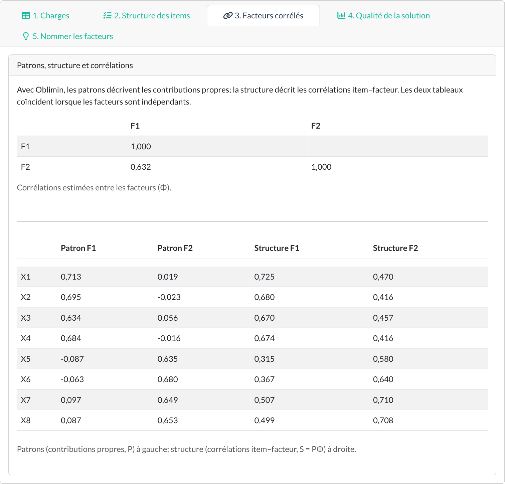

# Extraire et tourner une solution {#sec-extraire}

```{r}
#| include: false
source("_common.R")
non_tournee <- suppressWarnings(ajuster_afe(fil, 2, "none", "ML"))
uls <- suppressWarnings(ajuster_afe(fil, 2, "oblimin", "ULS"))
ecart_uls <- max(abs(uls$loadings - fil_afe$loadings))
cr <- simuler("correlated")
cr_obl <- suppressWarnings(ajuster_afe(cr, 2, "oblimin", "ML"))
cr_var <- suppressWarnings(ajuster_afe(cr, 2, "varimax", "ML"))
sec <- function(M) apply(abs(M), 1, function(r) sort(r, decreasing = TRUE)[2])
```

::: {.callout-note appearance="simple" title="Dans ce chapitre"}
- choisir une méthode d’extraction et savoir ce qu’elle change (et ne change pas);
- comprendre l’indétermination de rotation : une infinité de solutions ajustent également les données;
- distinguer Varimax (facteurs indépendants) et Oblimin (facteurs corrélés);
- lire la matrice des patrons, la matrice de structure et les corrélations entre facteurs;
- ne pas surinterpréter le signe ou l’ordre des facteurs.
:::

> **Idée centrale.** L’extraction fixe l’**espace** des facteurs; la rotation choisit seulement une **orientation** dans cet espace, celle qui rend la lecture la plus simple. Toutes les rotations reproduisent exactement les mêmes corrélations : le choix entre elles est une décision sur la nature des facteurs (indépendants ou non), pas sur l’ajustement.

Une fois le nombre de facteurs posé comme hypothèse de travail, simEFA permet de choisir la méthode d’extraction et la rotation dans **Paramètres de l’analyse**. Ces choix facilitent la lecture; ils ne créent pas automatiquement une bonne mesure.

## Trois extractions dans l’application

Extraire, c’est estimer les charges et les unicités qui reproduisent le mieux la matrice de corrélation observée. Les méthodes diffèrent par la façon de mesurer l’écart entre la matrice observée et la matrice reproduite.

| Méthode | Idée générale | Quand elle est utile |
|:--|:--|:--|
| ML | Maximum de vraisemblance : trouve les paramètres qui rendent les données observées les plus probables sous une loi normale multivariée | Items approximativement continus; fournit un $\chi^2$ et des indices d’ajustement |
| MLR | Maximum de vraisemblance robuste : mêmes estimations que ML, mais erreurs types et tests corrigés pour les écarts à la normalité | Même logique, avec des items asymétriques ou aplatis |
| ULS | Moindres carrés non pondérés : minimise la somme des carrés des résidus de corrélation | Alternative moins dépendante de la normalité; proche de la méthode « minres » |

: Les méthodes d’extraction de simEFA. {#tbl-extractions}

Ces méthodes peuvent produire des solutions semblables sur des données simples et diverger lorsque la structure est fragile. Pour le cas fil rouge, les charges ML et ULS ne diffèrent jamais de plus de `r fr(ecart_uls, 3)`, et MLR redonne exactement les charges ML (seuls les tests changent). Il est bon de savoir quelle méthode a été choisie, mais il serait trompeur de multiplier les extractions jusqu’à obtenir le résultat souhaité. Le choix doit être annoncé avant la lecture finale [@fabrigar1999; @goretzko2021].

## Pourquoi une rotation?

Avec plus d’un facteur, la solution n’est pas unique. Si $\Lambda$ est une matrice de charges qui reproduit les corrélations, alors $\Lambda T$, pour toute matrice $T$ de rotation, les reproduit tout aussi bien. Géométriquement, les items sont des points dans le plan des facteurs; on peut faire pivoter les axes autour de l’origine sans déplacer les points. Les charges (les coordonnées des points) changent; les distances entre points, donc l’ajustement, non.

Avant rotation, une solution peut représenter correctement la variance commune, tout en étant difficile à lire : plusieurs items chargent modérément sur plusieurs facteurs. La rotation recherche une orientation plus simple sans changer l’espace factoriel retenu. Elle vise une **structure simple** : chaque item fortement lié à un seul facteur et faiblement aux autres.

```{r}
#| label: fig-rotation
#| fig-cap: "Cas fil rouge. Les points sont les huit items placés selon leurs charges dans la solution non tournée de lavaan (axes gris). Les flèches orange indiquent les axes de la rotation oblique Oblimin : chacun traverse un nuage d'items. Dans ce nouveau repère, X1 à X4 se lisent sur le premier axe et X5 à X8 sur le second."
#| fig-height: 4.6
#| fig-width: 5.2
#| out-width: "62%"
P <- non_tournee$loadings
d <- data.frame(x = P[, 1], y = P[, 2], item = rownames(P), bloc = rep(c("X1–X4", "X5–X8"), each = 4))
# axes obliques : direction des centroïdes des deux blocs
ax <- rbind(colMeans(P[1:4, ]), colMeans(P[5:8, ]))
ax <- ax / sqrt(rowSums(ax^2))
axes <- data.frame(x = 0, y = 0, xend = ax[, 1] * 0.95, yend = ax[, 2] * 0.95, nom = c("F1 tourné", "F2 tourné"))
ggplot(d, aes(x, y)) +
  geom_hline(yintercept = 0, colour = "grey60") + geom_vline(xintercept = 0, colour = "grey60") +
  geom_segment(data = axes, aes(x = x, y = y, xend = xend, yend = yend), colour = pal$orange,
               arrow = arrow(length = unit(0.2, "cm")), linewidth = 1) +
  geom_text(data = axes, aes(x = xend, y = yend, label = nom), colour = pal$orange, size = 3.6,
            hjust = c(0, 0.5), nudge_x = c(0.04, 0), nudge_y = c(0, -0.07)) +
  geom_point(aes(colour = bloc), size = 2.6) +
  ggrepel::geom_text_repel(aes(label = item), size = 2.8, min.segment.length = 0, box.padding = 0.35,
                           max.overlaps = Inf, seed = 1, segment.colour = "grey60") +
  scale_colour_manual(values = c(pal$bleu, pal$vert), name = NULL) +
  coord_equal(xlim = c(-0.2, 1.25), ylim = c(-1, 0.5)) +
  scale_x_continuous(labels = axe_fr) + scale_y_continuous(labels = axe_fr) +
  labs(x = "Facteur 1 non tourné", y = "Facteur 2 non tourné")
```

Dans simEFA, la rotation est appliquée automatiquement lorsque vous modifiez le menu **Changer la méthode de rotation** après une première AFE. Il n’y a volontairement aucun bouton additionnel : changer de rotation signifie que l’on souhaite lire la même solution (mêmes items, mêmes personnes, même nombre de facteurs) dans une nouvelle orientation.

## Varimax, Oblimin ou aucune rotation

**Varimax** est une rotation **orthogonale** : les axes restent perpendiculaires et les facteurs sont imposés non corrélés. Elle cherche à rendre, pour chaque facteur, les charges soit grandes, soit proches de zéro. Elle est appropriée seulement si l’indépendance des facteurs est défendable ou désirée pour une raison précise.

**Oblimin** est une rotation **oblique** : les axes peuvent former un angle, et les facteurs peuvent corréler. C’est généralement le point de départ prudent en sciences humaines et sociales : des construits voisins sont rarement parfaitement indépendants. Si les facteurs sont en réalité indépendants, Oblimin le montrera en estimant des corrélations proches de zéro; l’inverse n’est pas vrai : Varimax ne peut jamais révéler une corrélation.

```{r}
#| label: fig-varimax
#| fig-cap: "Situation « Facteurs corrélés » (corrélation de population 0,55) : seconde charge (en valeur absolue) de chaque item selon la rotation. En forçant des facteurs indépendants, Varimax reporte la corrélation entre facteurs sur les items, qui semblent tous un peu ambigus. Oblimin l'attribue aux facteurs eux-mêmes et retrouve une structure simple."
#| fig-height: 3.2
dd <- data.frame(item = factor(rep(paste0("X", 1:8), 2), levels = paste0("X", 1:8)),
                 rotation = rep(c("Oblimin", "Varimax"), each = 8),
                 seconde = c(sec(cr_obl$loadings), sec(cr_var$loadings)))
ggplot(dd, aes(item, seconde, fill = rotation)) +
  geom_col(position = position_dodge(0.7), width = 0.65) +
  geom_hline(yintercept = 0.30, linetype = 2) +
  annotate("text", x = 0.6, y = 0.32, label = "seuil de lecture 0,30", hjust = 0, vjust = 0, size = 3.2) +
  scale_fill_manual(values = c(Oblimin = pal$bleu, Varimax = pal$orange), name = NULL) +
  scale_y_continuous(labels = axe_fr, limits = c(0, 0.45)) +
  labs(x = NULL, y = "Seconde charge (absolue)")
```

**Aucune rotation** sert surtout à comparer et à comprendre l’effet de la rotation. Dans lavaan, la solution non tournée est identifiée par des contraintes techniques (d’où le zéro de X1 sur le second facteur dans la @fig-rotation) : elle est rarement le meilleur tableau à interpréter dans un rapport final.

## Patrons, structure et corrélations entre facteurs

Avec une rotation oblique, chaque item reçoit deux séries de coefficients :

- les **patrons** $P$ (*pattern*) : la contribution **propre** de chaque facteur à l’item, en contrôlant les autres facteurs. Ce sont des coefficients de régression standardisés; ce sont eux que simEFA affiche comme « charges »;
- la **structure** $S=P\Phi$ : la **corrélation** simple entre l’item et chaque facteur, où $\Phi$ est la matrice des corrélations entre facteurs.

Les deux coïncident lorsque les facteurs sont indépendants. Lorsqu’ils sont corrélés, un item peut avoir un patron presque nul sur un facteur et pourtant une corrélation notable avec lui, simplement parce qu’il dépend d’un autre facteur qui lui est corrélé.

::: {.callout-note title="Situation « Facteurs corrélés »"}
Oblimin estime une corrélation de `r fr(cr_obl$factor_correlation[1, 2])` entre les facteurs (population : 0,55). L’item X1 a un patron de `r fr(cr_obl$loadings[1, 1], 3)` sur F1 et de `r fr(cr_obl$loadings[1, 2], 3)` sur F2 : il ne dépend que de F1. Mais sa corrélation avec F2 (structure) vaut `r fr(cr_obl$structure_loadings[1, 2], 3)`, soit à peu près $`r frm(cr_obl$loadings[1, 1], 3)`\times`r frm(cr_obl$factor_correlation[1, 2])`$ : X1 corrèle avec F2 *à travers* F1.
:::

{#fig-cap-correles .capture}

Dans simEFA, ouvrez **Interprétation ▸ 3. Facteurs corrélés** (@fig-cap-correles). Le tableau du haut montre l’ampleur de la relation estimée entre les facteurs; le tableau du bas juxtapose patrons et structure. Pour nommer un facteur, lisez d’abord les patrons (qui dit quoi, en propre); pour comprendre comment les facteurs se recouvrent, lisez la structure. Avec Varimax, l’application rappelle que les corrélations entre facteurs sont nulles par construction.

::: {.callout-tip title="Expérience guidée"}
Dans le scénario **Facteurs corrélés**, exécutez d’abord une rotation Oblimin. Notez les corrélations entre facteurs et les charges. Passez ensuite à Varimax. Une structure devenue plus « nette » est-elle nécessairement plus fidèle à la situation générée? Vérifiez dans **Aperçu des données ▸ Population simulée**.
:::

## Le signe et l’ordre des facteurs

Le signe d’un facteur est arbitraire : multiplier un facteur et toutes ses charges par $-1$ ne change pas le modèle. De même, l’ordre des facteurs peut changer selon la méthode ou l’échantillon. Interprétez donc le contenu et l’ampleur des charges, pas l’étiquette « Facteur 1 » comme si elle avait une signification intrinsèque. C’est pourquoi simEFA **aligne** l’ordre et le signe des facteurs avant de comparer une solution à la population simulée ou de résumer un bootstrap.

::: {.callout-important title="Règle de cohérence"}
Si vous permettez des facteurs corrélés, rapportez et interprétez ces corrélations. Utiliser Oblimin puis présenter les facteurs comme indépendants est incohérent.
:::

## Laboratoire

::: {.callout-tip title="Dans simEFA"}
Dans la situation **Facteurs corrélés** (graine 1234), comparez les deux rotations dans **Interprétation ▸ 2. Structure des items** : combien d’items ont une « seconde charge notable » avec chacune? Pourquoi les communalités, elles, ne changent-elles pas?
:::

::: {.callout-note collapse="true" title="Réponse"}
```{r}
#| include: false
st_o <- summarise_simple_structure(cr_obl$loadings, cr_obl$communality)
st_v <- summarise_simple_structure(cr_var$loadings, cr_var$communality)
```
Avec Oblimin, `r sum(st_o$Statut != "structure simple")` item n’a de seconde charge notable : les huit sont à structure simple. Avec Varimax, `r sum(st_v$Statut != "structure simple")` items (`r paste(st_v$Item[st_v$Statut != "structure simple"], collapse = " et ")`) dépassent 0,30 sur le second facteur (@fig-varimax). Les communalités sont identiques dans les deux cas (par exemple `r fr(cr_obl$communality["X1"], 3)` pour X1) : la rotation ne change que l’orientation des axes, pas la part de variance de chaque item reproduite par l’ensemble des facteurs.
:::

## À retenir

- L’extraction (ML, MLR, ULS) estime l’espace factoriel; sur des données simples, les méthodes concordent.
- Une infinité de rotations ajustent également les données; la rotation sert la lisibilité.
- Varimax impose des facteurs indépendants; Oblimin les laisse corréler et peut révéler une indépendance, l’inverse étant impossible.
- Avec Oblimin : patrons = contributions propres, structure = corrélations, $S=P\Phi$.
- Le signe et l’ordre des facteurs sont arbitraires.

## Quiz

1. Une rotation améliore-t-elle l’ajustement du modèle aux données?
2. Deux facteurs sont corrélés à 0,50. Un item a des patrons de 0,80 et 0,00. Que vaut sa corrélation avec le second facteur?
3. Pourquoi Oblimin est-il un point de départ plus prudent que Varimax?
4. Vous obtenez des charges toutes négatives sur F2. Faut-il s’en inquiéter?
5. Que change MLR par rapport à ML?

::: {.callout-note collapse="true" title="Réponses du quiz"}
1. Non : toutes les rotations reproduisent exactement les mêmes corrélations.
2. $0{,}80\times0{,}50=0{,}40$.
3. Il estime la corrélation entre facteurs au lieu de l’imposer à zéro; si elle est nulle, il le montrera.
4. Non : le signe d’un facteur est arbitraire. On peut lire F2 « à l’envers ».
5. Les erreurs types et les tests, rendus robustes aux écarts à la normalité; les charges sont les mêmes.
:::
