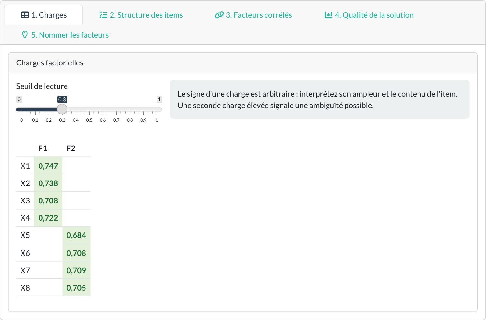
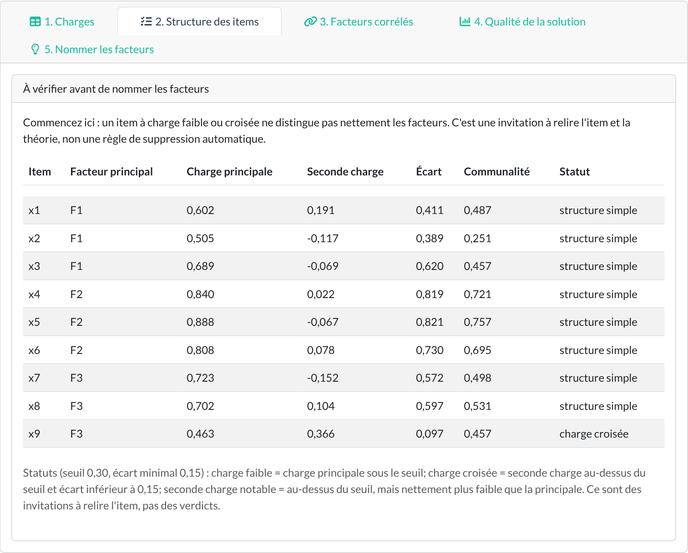
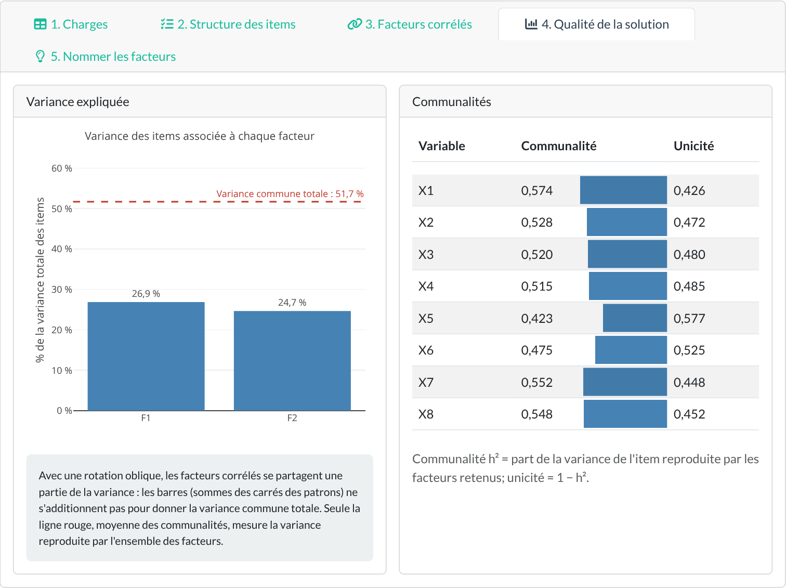

# Interpréter la solution factorielle {#sec-interpreter}

```{r}
#| include: false
source("_common.R")
hs <- lavaan::HolzingerSwineford1939[, paste0("x", 1:9)]
hs_afe <- suppressWarnings(ajuster_afe(hs, 3, "oblimin", "ML"))
hs_st <- summarise_simple_structure(hs_afe$loadings, hs_afe$communality)
cx <- simuler("cross")
cx_afe <- suppressWarnings(ajuster_afe(cx, 2, "oblimin", "ML"))
cx_var <- suppressWarnings(ajuster_afe(cx, 2, "varimax", "ML"))
st30 <- summarise_simple_structure(cx_afe$loadings, cx_afe$communality, .30)
st25 <- summarise_simple_structure(cx_afe$loadings, cx_afe$communality, .25)
stv <- summarise_simple_structure(cx_var$loadings, cx_var$communality, .30)
```

::: {.callout-note appearance="simple" title="Dans ce chapitre"}
- lire des charges standardisées sans seuil mécanique;
- classer chaque item : structure simple, seconde charge notable, charge croisée, charge faible;
- interpréter les communalités avec les charges;
- nommer un facteur à partir du contenu des items, pas des nombres;
- rédiger une description de résultats honnête.
:::

> **Idée centrale.** Un facteur n’a pas de nom avant que l’on ait lu ses items. Les charges disent **quels** items définissent un facteur et avec quelle netteté; seul le contenu de ces items dit **ce qu’il mesure**.

L’onglet **Interprétation** de simEFA est organisé dans l’ordre où une solution devrait être lue : charges, structure des items, facteurs corrélés, qualité de la solution, puis nom des facteurs. Nommer un facteur avant d’avoir regardé les items faibles ou ambigus invite à raconter une histoire trop vite.

## Lire des charges standardisées

Une charge standardisée exprime la relation entre un item et un facteur sur une échelle comparable, de −1 à 1. Avec une rotation orthogonale, c’est une corrélation et son carré est la part de variance de l’item associée au facteur. Avec une rotation oblique, c’est un coefficient de régression (un patron) : son carré n’est qu’une approximation de cette part.

Il n’existe pas de seuil universel. Les repères 0,30, 0,40 ou 0,50 décrivent des degrés de force (une charge de 0,30 correspond à environ 9 % de variance commune, une charge de 0,50 à 25 %), mais leur importance dépend du nombre d’items, de la taille d’échantillon et de l’usage prévu de l’échelle.

simEFA affiche des charges entièrement standardisées. C’est essentiel : les coefficients bruts d’un modèle dépendent de l’échelle des items et ne doivent pas être comparés directement à un seuil tel que 0,30. Si une charge standardisée dépasse 1, l’application l’indique : il s’agit d’une **solution impropre** (une unicité estimée négative, appelée cas de Heywood), pas d’une relation exceptionnellement forte.

{#fig-cap-charges .capture width="75%"}

Dans **1. Charges** (@fig-cap-charges), modifiez le **Seuil de lecture**. Utilisez-le pour rendre le tableau lisible, non pour effacer arbitrairement tout ce qui est juste sous la frontière. Une charge de 0,29 n’est pas substantiellement différente d’une charge de 0,30.

## Charges croisées et écart entre les deux meilleures charges

Un item présente une charge croisée lorsqu’il est lié à plus d’un facteur. L’onglet **2. Structure des items** résume, pour chaque item, la charge principale, la seconde charge et leur écart, puis lui attribue un statut :

| Statut | Règle (seuil s, écart 0,15) | Lecture raisonnable |
|:--|:--|:--|
| Structure simple | charge principale ≥ s, seconde < s | Item relativement spécifique à un facteur |
| Seconde charge notable | seconde ≥ s, écart ≥ 0,15 | Item surtout lié à un facteur, avec un lien secondaire réel |
| Charge croisée | seconde ≥ s, écart < 0,15 | Item ambigu ou construits étroitement liés |
| Charge faible | charge principale < s | Item possiblement peu relié à la structure commune |

: Les statuts de l’onglet « 2. Structure des items ». {#tbl-statuts}

Un signe opposé sur un facteur peut refléter un item inversé ou un contenu opposé : interprétez le texte. Une charge croisée ne dicte pas automatiquement une suppression. Demandez plutôt : l’item couvre-t-il deux contenus? Son libellé est-il trop général? Les facteurs sont-ils presque le même construit? Une solution oblique a-t-elle été choisie?

::: {.callout-note title="Exemple réel : Holzinger et Swineford (1939)"}
Neuf tests passés par 301 élèves, trois facteurs attendus : **visuel** (x1 perception visuelle, x2 cubes, x3 losanges), **verbal** (x4 compréhension de paragraphes, x5 complétion de phrases, x6 sens des mots) et **vitesse** (x7 additions rapides, x8 comptage de points, x9 discrimination de majuscules droites et courbes). L’analyse parallèle suggère trois facteurs; la solution ML avec Oblimin est présentée à la @fig-hs.
:::

```{r}
#| label: fig-hs
#| fig-cap: "Holzinger et Swineford : charges (patrons) de la solution à trois facteurs, ML, Oblimin. Les cases foncées sont les charges fortes. Le test x9 (discrimination rapide de majuscules droites et courbes) charge à la fois sur le facteur de vitesse et sur le facteur visuel."
#| fig-height: 3.6
noms <- c(x1 = "x1 Perception visuelle", x2 = "x2 Cubes", x3 = "x3 Losanges", x4 = "x4 Paragraphes",
          x5 = "x5 Complétion de phrases", x6 = "x6 Sens des mots", x7 = "x7 Additions rapides",
          x8 = "x8 Comptage de points", x9 = "x9 Majuscules droites/courbes")
L <- hs_afe$loadings
d <- data.frame(item = rep(noms[rownames(L)], 3), facteur = rep(c("F1", "F2", "F3"), each = 9), v = c(L))
d$item <- factor(d$item, levels = rev(noms))
ggplot(d, aes(facteur, item, fill = v)) +
  geom_tile(colour = "white") +
  geom_text(aes(label = fr(v)), size = 3.4, colour = ifelse(abs(d$v) > .45, "white", "black")) +
  scale_fill_gradient2(low = pal$rouge, mid = "white", high = "#08519c", limits = c(-1, 1), guide = "none") +
  labs(x = NULL, y = NULL) + theme(panel.grid = element_blank())
```

Le test x9 a une charge de `r fr(L["x9", 3])` sur le facteur de vitesse et de `r fr(L["x9", 1])` sur le facteur visuel; l’écart (`r fr(L["x9", 3] - L["x9", 1])`) est inférieur à 0,15 : c’est une **charge croisée**. Le contenu l’explique : distinguer rapidement des lettres droites et courbes exige à la fois de la vitesse et une discrimination visuelle. L’item n’est pas « mauvais »; il est complexe, et il faudra décider s’il sert un score de vitesse, un score visuel, ou aucun des deux.

{#fig-cap-structure .capture}

### Le statut dépend des choix de lecture

Un statut n’est pas une propriété de l’item seul : il dépend du seuil, de la rotation et de l’échantillon.

::: {.callout-note title="Situation « Items ambigus »"}
Dans cette situation, la population donne aux items X1, X7 et X8 une seconde charge de 0,30 (onglet **Population simulée**). Avec Oblimin et un seuil de 0,30, les secondes charges estimées (de `r fr(min(abs(st30$Seconde_charge[c(1, 7, 8)])), 3)` à `r fr(max(abs(st30$Seconde_charge[c(1, 7, 8)])), 3)`) restent sous le seuil et les huit items paraissent « à structure simple ». Abaissez le seuil à 0,25 : ces trois items passent à « seconde charge notable ». Avec Varimax et un seuil de 0,30, `r sum(stv$Statut == "charge croisée")` items deviennent des charges croisées, parce que Varimax reporte sur les items la corrélation entre facteurs.
:::

La leçon est double : un seuil légèrement différent change le verdict d’un item limite, et la rotation choisie aussi. Rapportez donc les secondes charges importantes plutôt que le seul statut.

## Communalités

La communalité est la proportion de variance d’un item expliquée par l’ensemble des facteurs retenus. Une faible communalité peut indiquer que l’item est mal représenté par la solution. Dans **4. Qualité de la solution**, examinez les communalités avec les charges : un item peut avoir une charge modérée sur un facteur, mais demeurer insuffisamment représenté dans l’ensemble.

::: {.callout-note title="Holzinger et Swineford"}
Le test x2 (cubes) a une charge principale de `r fr(L["x2", 1])` et une communalité de `r fr(hs_afe$communality["x2"])` : les trois facteurs n’expliquent qu’un quart de sa variance. Les tests verbaux x4 à x6, eux, ont des communalités de `r fr(min(hs_afe$communality[c("x4", "x5", "x6")]))` à `r fr(max(hs_afe$communality[c("x4", "x5", "x6")]))`. Le facteur verbal est le mieux mesuré des trois.
:::

Comme les charges, une communalité n’offre pas de seuil universel. Dans une échelle courte ou au début d’un travail de développement, une valeur imparfaite peut être acceptable si l’item représente un contenu important que les autres items ne couvrent pas.

{#fig-cap-qualite .capture}

Le graphique de la @fig-cap-qualite appelle une précaution. Avec une rotation oblique, les facteurs corrélés se partagent une partie de la variance : les barres (sommes des carrés des patrons de chaque facteur) ne s’additionnent pas pour donner la variance commune totale. Seule la ligne rouge, la moyenne des communalités (`r pc(fil_afe$variance_commune)` pour le cas fil rouge), mesure la variance reproduite par l’ensemble des facteurs.

## Nommer un facteur

Dans **5. Nommer les facteurs**, l’application propose des pistes à partir des charges : quels items définissent le facteur, avec quelle netteté. Elles organisent le tableau; elles ne connaissent pas le sens des items. Le nom doit être construit à partir des formulations, de la théorie et de ce que les items partagent réellement.

Une bonne étiquette est concise et descriptive. Elle ne doit pas promettre plus que les items. Trois items sur « je me sens calme », « je me détends facilement » et « je suis peu inquiet » peuvent soutenir *calme perçu*; ils ne justifient pas automatiquement *santé mentale globale*. Pour Holzinger et Swineford, *aptitude visuo-spatiale*, *aptitude verbale* et *vitesse de traitement* restent fidèles aux tests.

::: {.callout-tip title="Méthode de lecture"}
1. Lisez les items ayant les charges principales les plus fortes.
2. Cherchez leur contenu commun, avant de regarder l’étiquette suggérée.
3. Vérifiez les charges secondaires et les communalités.
4. Écrivez un nom provisoire, puis demandez ce qui le contredit.
5. Conservez une trace des décisions et de leurs justifications.
:::

## Une formulation de résultats

Un rapport concis précise la matrice analysée, l’extraction, la rotation, la règle utilisée pour le nombre de facteurs et les principaux diagnostics. Il présente ensuite les facteurs en donnant les items les plus représentatifs, l’étendue des charges, les communalités problématiques, les corrélations entre facteurs lorsque la rotation est oblique et toute décision concernant les items ambigus. Pour Holzinger et Swineford :

> Une AFE (maximum de vraisemblance, rotation Oblimin) a été réalisée sur les neuf tests ($n=301$). L’analyse parallèle suggérait trois facteurs, conformément à l’attente théorique. Le facteur verbal (x4 à x6, charges de `r fr(min(L[c("x4", "x5", "x6"), 2]))` à `r fr(max(L[c("x4", "x5", "x6"), 2]))`) était le mieux défini; le facteur visuel (x1 à x3, `r fr(min(L[c("x1", "x2", "x3"), 1]))` à `r fr(max(L[c("x1", "x2", "x3"), 1]))`) et le facteur de vitesse (x7 et x8, `r fr(min(L[c("x7", "x8"), 3]))` à `r fr(max(L[c("x7", "x8"), 3]))`) l’étaient moins nettement. Le test x9 chargeait sur la vitesse (`r fr(L["x9", 3])`) et sur le facteur visuel (`r fr(L["x9", 1])`). Les facteurs étaient modérément corrélés (`r fr(min(hs_afe$factor_correlation[upper.tri(hs_afe$factor_correlation)]))` à `r fr(max(hs_afe$factor_correlation[upper.tri(hs_afe$factor_correlation)]))`). Le test x2 était faiblement représenté ($h^2=`r frm(hs_afe$communality["x2"])`$).

::: {.callout-warning title="À éviter"}
Évitez de décrire un facteur uniquement par sa variance expliquée, de supprimer des items uniquement pour augmenter un indice, ou de présenter une étiquette de facteur sans montrer quels items la soutiennent.
:::

## Laboratoire

::: {.callout-tip title="Dans simEFA"}
Dans la situation **Items ambigus** (graine 1234), exécutez l’AFE à deux facteurs avec Oblimin. Ouvrez **Interprétation ▸ 2. Structure des items**, puis faites varier le **Seuil de lecture** (onglet **1. Charges**) de 0,30 à 0,25. Comparez avec les charges de population.
:::

::: {.callout-note collapse="true" title="Réponse"}
À 0,30, les huit items sont classés « structure simple ». À 0,25, les items `r paste(st25$Item[st25$Statut != "structure simple"], collapse = ", ")` passent à « seconde charge notable ». Ce sont exactement les trois items auxquels la population donne une seconde charge de 0,30. Les estimations (de `r fr(min(abs(st30$Seconde_charge[c(1, 7, 8)])), 3)` à `r fr(max(abs(st30$Seconde_charge[c(1, 7, 8)])), 3)`) sont un peu plus faibles que 0,30 parce que la rotation oblique attribue une partie de leur lien secondaire à la corrélation entre facteurs. Un seuil n’est pas une frontière naturelle : il faut regarder les valeurs.
:::

## À retenir

- Une charge standardisée oblique est un patron (contribution propre); son carré n’est qu’une approximation de la variance expliquée.
- Les statuts (simple, seconde charge notable, croisée, faible) sont des invitations à relire l’item, pas des verdicts.
- Un statut dépend du seuil, de la rotation et de l’échantillon.
- La communalité dit si l’item est bien représenté par l’ensemble des facteurs.
- Un facteur se nomme d’après le contenu de ses items, sans promettre plus qu’eux.

## Quiz

1. Une charge standardisée vaut 1,08. Que faut-il en penser?
2. Un item a des charges de 0,52 et 0,44. Quel est son statut avec un seuil de 0,30?
3. Pourquoi, avec Oblimin, les barres de variance par facteur ne s’additionnent-elles pas?
4. Un item a une charge de 0,45 et une communalité de 0,21. Est-ce contradictoire?
5. Trois items sur la fatigue, le sommeil et l’appétit chargent sur un même facteur. Peut-on le nommer « dépression »?

::: {.callout-note collapse="true" title="Réponses du quiz"}
1. C’est une solution impropre (cas de Heywood) : revoir le nombre de facteurs, les items redondants, l’échantillon.
2. Charge croisée : seconde charge au-dessus du seuil et écart (0,08) inférieur à 0,15.
3. Les facteurs corrélés se recouvrent : une partie de la variance est comptée deux fois.
4. Non : $0{,}45^2\approx0{,}20$; l’item est lié à un seul facteur, modérément, et reste surtout propre.
5. Pas sans prudence : *symptômes somatiques* est plus fidèle aux items; *dépression* promet un contenu qu’ils ne couvrent pas.
:::
