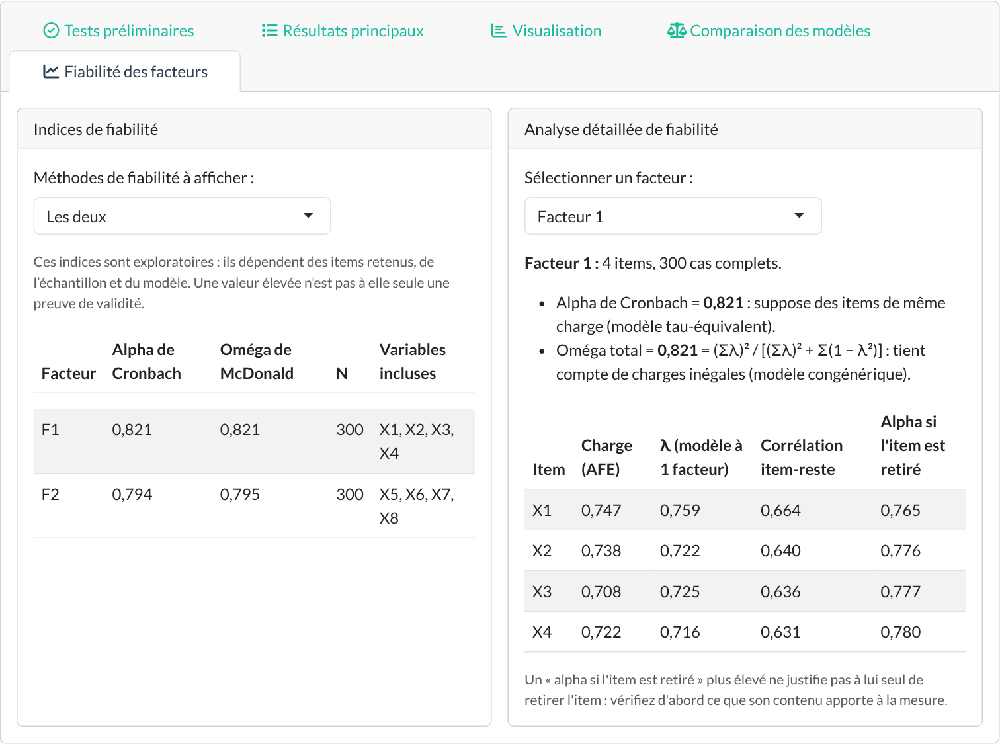
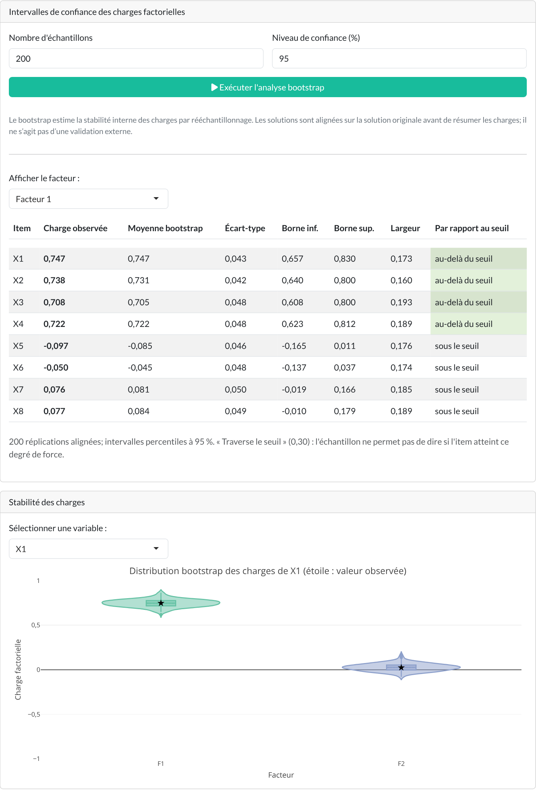

# Stabilité, fiabilité et prudence {#sec-stabilite}

```{r}
#| include: false
source("_common.R")
fiab <- t(sapply(list(F1 = paste0("X", 1:4), F2 = paste0("X", 5:8)), function(it) {
  d <- fil[, it]
  c(alpha = suppressWarnings(psych::alpha(d, warnings = FALSE)$total$raw_alpha), omega = omega_sous_echelle(d)$omega)
}))
# Alpha et oméga pour des charges égales ou inégales (population simulée, n = 5 000)
set.seed(1); n <- 5000; Fv <- rnorm(n)
gen <- function(lam) as.data.frame(sapply(lam, function(l) l * Fv + rnorm(n, 0, sqrt(1 - l^2))))
ineg <- gen(c(.9, .8, .4, .3)); eg <- gen(c(.65, .6, .6, .55))
a_ineg <- suppressWarnings(psych::alpha(ineg, warnings = FALSE)$total$raw_alpha); o_ineg <- omega_sous_echelle(ineg)$omega
a_eg <- suppressWarnings(psych::alpha(eg, warnings = FALSE)$total$raw_alpha); o_eg <- omega_sous_echelle(eg)$omega
```

::: {.callout-note appearance="simple" title="Dans ce chapitre"}
- distinguer l’alpha de Cronbach et l’oméga de McDonald, et savoir quand ils divergent;
- comprendre pourquoi les items ambigus sont exclus du calcul de fiabilité;
- lire des intervalles bootstrap de charges et leur largeur;
- savoir ce que le bootstrap peut et ne peut pas établir.
:::

> **Idée centrale.** Une solution lisible sur un échantillon reste une estimation. La fiabilité dit si un score composé de quelques items est précis; le bootstrap dit si la solution elle-même tiendrait dans des échantillons comparables. Ni l’un ni l’autre ne dit si l’on mesure le bon construit.

Une solution factorielle lisible sur un seul échantillon n’est pas nécessairement stable. simEFA propose deux angles complémentaires : les indices de fiabilité (**Analyse factorielle ▸ Fiabilité des facteurs**) et le bootstrap (onglet **Bootstrap**).

## Fiabilité : de quel score parle-t-on?

Dans **Fiabilité des facteurs**, l’application calcule l’alpha de Cronbach et l’oméga de McDonald pour les items associés de façon nette à un facteur : charge principale au-dessus du seuil de lecture, seconde charge nettement plus faible (écart d’au moins 0,15). Les items ambigus sont écartés de ce calcul afin d’éviter de faire semblant qu’ils appartiennent sans réserve à une seule sous-échelle. Le tableau indique aussi le nombre de cas complets utilisé pour chaque sous-échelle; ne comparez pas des indices fondés sur des échantillons très différents sans le signaler.

{#fig-cap-fiabilite .capture}

### Alpha et oméga

L’**alpha** de Cronbach mesure une cohérence interne sous des hypothèses restrictives : il suppose que tous les items ont la **même charge** sur le facteur (modèle dit tau-équivalent). Un alpha élevé ne prouve ni l’unidimensionnalité ni la validité. Une longue échelle peut avoir un alpha élevé même si certains items sont redondants.

L’**oméga** total s’appuie sur les charges d’un modèle à un facteur ajusté aux items de la sous-échelle (modèle dit congénérique, où chaque item a sa propre charge) :

$$\omega=\frac{\left(\sum_j\lambda_j\right)^2}{\left(\sum_j\lambda_j\right)^2+\sum_j\left(1-\lambda_j^2\right)}.$$

Le numérateur est la variance du score total due au facteur commun; le dénominateur, sa variance totale. L’oméga est la proportion de la variance d’un score total qui provient du facteur [@revelle2025].

```{r}
#| label: fig-alpha-omega
#| fig-cap: "Alpha et oméga pour deux sous-échelles de quatre items (5 000 personnes simulées). Avec des charges presque égales, les deux indices coïncident. Avec des charges très inégales (0,90, 0,80, 0,40, 0,30), l'alpha sous-estime la fiabilité du score, parce qu'il suppose à tort des items interchangeables."
#| fig-height: 3
d <- data.frame(echelle = rep(c("Charges égales\n(0,65 à 0,55)", "Charges inégales\n(0,90 à 0,30)"), each = 2),
                indice = rep(c("Alpha", "Oméga"), 2), v = c(a_eg, o_eg, a_ineg, o_ineg))
ggplot(d, aes(echelle, v, fill = indice)) +
  geom_col(position = position_dodge(0.7), width = 0.6) +
  geom_text(aes(label = fr(v)), position = position_dodge(0.7), vjust = -0.4, size = 3.4) +
  scale_fill_manual(values = c(Alpha = pal$orange, "Oméga" = pal$bleu), name = NULL) +
  scale_y_continuous(labels = axe_fr, limits = c(0, 0.85)) +
  labs(x = NULL, y = "Fiabilité estimée")
```

::: {.callout-note title="Cas fil rouge"}
Les charges de population sont égales (0,70) : alpha et oméga coïncident presque. Sous-échelle F1 (X1 à X4) : alpha = `r fr(fiab["F1", "alpha"], 3)`, oméga = `r fr(fiab["F1", "omega"], 3)`; sous-échelle F2 (X5 à X8) : alpha = `r fr(fiab["F2", "alpha"], 3)`, oméga = `r fr(fiab["F2", "omega"], 3)`. Chaque score de quatre items est raisonnablement fiable, bien que chaque item, pris isolément, ne partage que la moitié de sa variance avec le facteur.
:::

L’analyse détaillée (carte de droite) donne, pour chaque item, sa charge dans l’AFE, sa charge dans le modèle à un facteur, sa corrélation avec la somme des autres items (corrélation item-reste) et l’alpha qu’aurait l’échelle sans lui. Un « alpha si l’item est retiré » plus élevé ne justifie pas à lui seul de retirer l’item : vérifiez d’abord ce que son contenu apporte à la mesure.

::: {.callout-important title="Fiabilité ≠ validité"}
Un score peut être cohérent sans mesurer le construit annoncé. Inversement, une sous-échelle très courte peut mesurer un contenu important tout en ayant une précision limitée. La validité exige aussi une analyse du contenu, des relations avec d’autres variables et de la structure factorielle.
:::

## Ce que fait le bootstrap

Le bootstrap rééchantillonne les personnes, avec remise, puis réexécute l’analyse. Chaque échantillon bootstrap a la même taille que l’échantillon original; certaines personnes y figurent deux ou trois fois, d’autres pas du tout. La dispersion des charges d’un rééchantillon à l’autre imite la dispersion qu’on observerait d’un échantillon réel à l’autre.

Dans l’onglet **Bootstrap**, choisissez le nombre d’échantillons et le niveau de confiance. Avant de résumer les répliques, simEFA aligne chaque solution sur la solution initiale (ordre et signe des facteurs) : il évite ainsi de mélanger artificiellement deux facteurs dont l’ordre ou le signe aurait changé. Les intervalles sont **percentiles** : pour un niveau de 95 %, on prend les 2,5^e^ et 97,5^e^ centiles des charges bootstrap.

```{r}
#| label: fig-bootstrap
#| fig-cap: "Intervalles bootstrap à 95 % (200 réplications) de la charge principale de chaque item. À gauche, le cas fil rouge (300 personnes, charges 0,70); à droite, la situation fragile (100 personnes, charges 0,50). Les points sont les charges observées; la ligne pointillée marque le seuil de lecture 0,30."
#| fig-height: 3.6
#| cache: true
boot_ic <- function(d, q, ref, B = 200, graine = 2026) {
  set.seed(graine)
  reps <- lapply(seq_len(B), function(b) {
    r <- tryCatch(suppressWarnings(ajuster_afe(d[sample(nrow(d), replace = TRUE), ], q, "oblimin", "ML", maxit = 500)),
                  error = function(e) NULL)
    if (is.null(r) || !r$converged) NULL else align_bootstrap_loadings(ref, r$loadings[rownames(ref), , drop = FALSE])
  })
  reps <- Filter(Negate(is.null), reps)
  fp <- apply(abs(ref), 1, which.max)
  do.call(rbind, lapply(seq_len(nrow(ref)), function(i) {
    v <- sapply(reps, function(m) m[i, fp[i]])
    data.frame(item = rownames(ref)[i], facteur = paste0("F", fp[i]), obs = ref[i, fp[i]],
               lo = quantile(v, .025), hi = quantile(v, .975))
  }))
}
frag <- simuler("fragile")
frag_afe <- suppressWarnings(ajuster_afe(frag, 3, "oblimin", "ML"))
b1 <- boot_ic(fil, 2, fil_afe$loadings); b1$cas <- "Cas fil rouge"
b2 <- boot_ic(frag, 3, frag_afe$loadings); b2$cas <- "Situation fragile"
bb <- rbind(b1, b2); bb$item <- factor(bb$item, levels = rev(paste0("X", 1:9)))
ggplot(bb, aes(y = item)) +
  geom_vline(xintercept = 0.30, linetype = 2, colour = "grey40") +
  geom_errorbarh(aes(xmin = lo, xmax = hi, colour = facteur), height = 0.3, linewidth = 0.9) +
  geom_point(aes(x = obs, colour = facteur), size = 2.2) +
  facet_wrap(~cas, scales = "free_y") +
  scale_colour_manual(values = c(F1 = pal$bleu, F2 = pal$vert, F3 = pal$violet), name = "Facteur principal") +
  scale_x_continuous(labels = axe_fr, limits = c(-0.2, 1.05)) +
  labs(x = "Charge principale", y = NULL)
```

```{r}
#| include: false
larg1 <- mean(b1$hi - b1$lo); larg2 <- mean(b2$hi - b2$lo)
trav <- b2$item[b2$lo < 0.30]
```

Un intervalle large indique qu’une charge est estimée avec peu de précision. Dans le cas fil rouge, les intervalles ont une largeur moyenne de `r fr(larg1)`; dans la situation fragile, de `r fr(larg2)`, soit `r fr(larg2 / larg1, 1)` fois plus (@fig-bootstrap). Si l’intervalle traverse un seuil de lecture choisi, ce seuil ne doit pas être traité comme une frontière certaine : l’échantillon ne permet pas de dire si l’item atteint ce degré de force. Dans la situation fragile, c’est le cas de `r length(trav)` items sur 9. Une charge qui change régulièrement de signe ou de facteur mérite une attention particulière.

{#fig-cap-bootstrap .capture}

Le tableau de l’application (@fig-cap-bootstrap) ajoute une colonne **Par rapport au seuil** : « au-delà du seuil » si tout l’intervalle dépasse le seuil de lecture, « sous le seuil » s’il reste en deçà, « traverse le seuil » sinon. Le graphique placé sous le tableau montre, pour un item choisi, la distribution de ses charges sur chaque facteur; l’étoile marque la valeur observée.

Le bootstrap n’est pas une validation externe : il ne crée pas une nouvelle population et ne corrige ni des items mal conçus ni un échantillon biaisé. Il répond plutôt à la question : *à quel point cette solution semble-t-elle dépendre de fluctuations d’échantillonnage internes?*

## Activité de stabilité

1. Dans le scénario **Structure claire**, conservez les réglages par défaut et exécutez l’AFE.
2. Lancez un bootstrap avec 200 rééchantillonnages.
3. Observez un item à charge forte, puis un item à charge plus faible.
4. Répétez avec le scénario **Petit échantillon / structure fragile**.
5. Comparez la largeur des intervalles et la stabilité de l’attribution des items.

Augmenter énormément le nombre de rééchantillonnages rend les estimations du bootstrap plus précises, mais ne transforme pas une information faible en information forte. Commencez modestement pour l’apprentissage; augmentez le nombre de répliques dans une analyse finale si le temps de calcul le permet.

## Au-delà des indices

La qualité d’une échelle est un argument cumulatif. Une structure claire, une cohérence interne raisonnable, des charges stables et une bonne couverture du construit sont plus convaincantes ensemble qu’isolément. Le but n’est pas d’atteindre une valeur symbolique, mais de produire une mesure qui sert la décision ou la recherche visée.

## Laboratoire

::: {.callout-tip title="Dans simEFA"}
Dans la situation fragile (graine 1234), exécutez l’AFE à trois facteurs, puis comparez la charge de l’item X6 aux charges de population (**Aperçu des données ▸ Population simulée**). Lancez ensuite un bootstrap de 200 réplications et regardez la distribution des charges de X6.
:::

::: {.callout-note collapse="true" title="Réponse"}
```{r}
#| include: false
pf <- pop_de(frag, "fragile")$loadings
al <- align_bootstrap_loadings(pf, frag_afe$loadings)
```
Dans la population, X6 dépend surtout du deuxième facteur (`r fr(pf["X6", 2])`), avec une petite charge secondaire sur le premier (`r fr(pf["X6", 1])`). Dans l’échantillon, une fois les facteurs alignés sur la population, X6 charge `r fr(al["X6", 1])` sur le premier facteur et `r fr(al["X6", 2])` sur le deuxième : l’item a « changé de facteur ». Avec 100 personnes et des charges de 0,50, une seule fluctuation suffit. Le bootstrap le montre : les charges de X6 se répartissent sur deux facteurs, et l’intervalle de sa charge principale est très large. Ce n’est pas un défaut de l’item, mais une limite de l’information disponible.
:::

## À retenir

- L’alpha suppose des charges égales; l’oméga utilise les charges réelles. Ils divergent quand les charges sont inégales.
- Les items ambigus sont exclus du calcul de fiabilité d’une sous-échelle.
- Le bootstrap rééchantillonne les personnes; ses intervalles mesurent la stabilité interne des charges.
- Un intervalle qui traverse le seuil de lecture rend incertain le statut de l’item.
- Ni la fiabilité ni le bootstrap n’établissent la validité.

## Quiz

1. Quatre items ont des charges de 0,80, 0,80, 0,30 et 0,30. Lequel de l’alpha ou de l’oméga sera le plus élevé?
2. Calculez l’oméga de trois items de charge 0,60.
3. Pourquoi simEFA aligne-t-il les solutions bootstrap avant de les résumer?
4. L’intervalle bootstrap d’une charge va de 0,18 à 0,52. Que peut-on dire avec un seuil de 0,30?
5. Un bootstrap très stable prouve-t-il que la structure se retrouvera dans une autre population?

::: {.callout-note collapse="true" title="Réponses du quiz"}
1. L’oméga : les charges sont inégales, l’alpha sous-estime.
2. $\left(3\times0{,}60\right)^2=3{,}24$; $\sum(1-\lambda^2)=3\times0{,}64=1{,}92$; $\omega=3{,}24/(3{,}24+1{,}92)=0{,}63$.
3. Parce que l’ordre et le signe des facteurs sont arbitraires; sans alignement, on mélangerait des facteurs différents.
4. Que l’échantillon ne permet pas de savoir si la charge atteint 0,30.
5. Non : le bootstrap ne quitte pas l’échantillon observé.
:::
