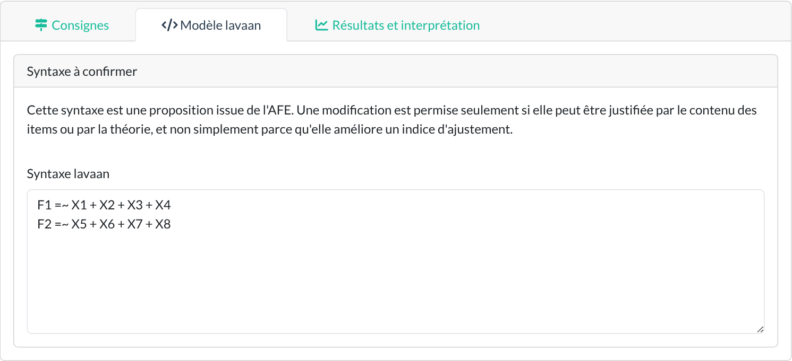
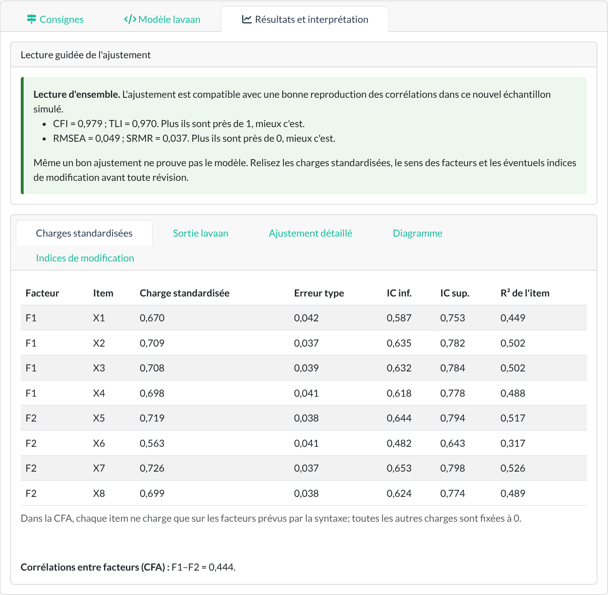

# De l’AFE à la validation CFA {#sec-cfa}

```{r}
#| include: false
source("_common.R")
valider <- function(sc, d, graine = 1235) {
  p <- SCENARIOS[[sc]]
  generate_efa_simulation(p$n, p$nf, p$nv, p$main, p$cross, p$prop, p$noise, TRUE, p$corr, graine,
                          loading_pattern = attr(d, "loading_pattern"))
}
indices <- c("chisq.scaled", "df", "pvalue.scaled", "cfi.robust", "tli.robust", "rmsea.robust", "srmr")
v_fil <- valider("clear", fil)
syn_fil <- convert_efa_to_cfa(fil_afe, .30, "primary")
cfa_fil <- lavaan::cfa(syn_fil, data = v_fil, std.lv = TRUE, estimator = "MLR")
f1 <- lavaan::fitMeasures(cfa_fil, indices)
st_fil <- lavaan::standardizedSolution(cfa_fil)
cx <- simuler("cross"); cx_afe <- suppressWarnings(ajuster_afe(cx, 2, "oblimin", "ML"))
v_cx <- valider("cross", cx)
cfa_cx <- lavaan::cfa(convert_efa_to_cfa(cx_afe, .30, "primary"), data = v_cx, std.lv = TRUE, estimator = "MLR")
f2 <- lavaan::fitMeasures(cfa_cx, indices)
mi <- lavaan::modificationIndices(cfa_cx, sort. = TRUE)
mi <- head(mi[, c("lhs", "op", "rhs", "mi")], 5)
cfa_cx2 <- lavaan::cfa(paste(convert_efa_to_cfa(cx_afe, .30, "primary"), "\nF2 =~ X1"), data = v_cx, std.lv = TRUE, estimator = "MLR")
f3 <- lavaan::fitMeasures(cfa_cx2, indices)
```

::: {.callout-note appearance="simple" title="Dans ce chapitre"}
- comprendre ce qu’ajoute une analyse confirmatoire (CFA) à une AFE;
- savoir pourquoi la confirmation exige de **nouvelles** données;
- traduire une solution exploratoire en syntaxe lavaan;
- lire CFI, TLI, RMSEA et SRMR avec retenue;
- utiliser les indices de modification comme des questions, pas des réponses.
:::

> **Idée centrale.** L’AFE propose une structure en laissant chaque item libre de charger partout. La CFA fixe à zéro tout ce que la proposition juge absent, puis demande à de nouvelles données si elles le permettent. Confirmer, c’est accepter de se faire contredire.

L’AFE propose une structure. Une analyse factorielle confirmatoire (CFA) évalue ensuite un modèle défini à l’avance : quels items chargent sur quel facteur, et quelles contraintes sont imposées. La CFA n’est pas une étape qui rend une AFE automatiquement vraie; elle oblige plutôt à tester plus explicitement ce qui a été proposé.

## Ce qui change entre AFE et CFA

Dans l’AFE à deux facteurs du cas fil rouge, chacun des 8 items a une charge sur chacun des 2 facteurs : 16 charges libres. La CFA candidate n’en garde que 8, une par item, et fixe les 8 autres à zéro. Ce sont ces zéros qui rendent le modèle **réfutable** : si un item dépend en réalité de deux facteurs, la CFA s’ajustera moins bien, et ses indices de modification le signaleront.

| | AFE | CFA |
|:--|:--|:--|
| Charges | toutes libres | seulement celles prévues; les autres = 0 |
| Rotation | nécessaire (solution indéterminée) | inutile (les zéros identifient le modèle) |
| Question | quelle structure les données suggèrent-elles? | la structure proposée est-elle compatible avec les données? |
| Données | échantillon de découverte | **nouvel** échantillon |

: AFE et CFA. {#tbl-afe-cfa}

## Pourquoi un nouvel échantillon?

Utiliser le même jeu de données pour découvrir puis confirmer une structure favorise un optimisme artificiel : la solution exploratoire s’est déjà adaptée aux particularités de cet échantillon (y compris à son bruit). simEFA exige donc un **nouvel échantillon simulé** avant l’analyse CFA. Il est généré avec les mêmes paramètres de population que les données de l’AFE (y compris le même patron d’items ambigus), mais avec de nouvelles personnes et une nouvelle erreur aléatoire. Une graine identique à celle de l’AFE est refusée : elle reproduirait le même échantillon.

::: {.callout-note title="Portée de cette validation"}
Cette réplication est pédagogique. Elle illustre la séparation entre découverte et confirmation, mais ne remplace pas une validation sur une nouvelle collecte réelle, idéalement dans une population pertinente et indépendamment recrutée.
:::

## Le déroulement dans simEFA

Après une AFE sur des données simulées, ouvrez **Validation CFA**. La barre latérale principale se replie afin que vous travailliez dans l’espace CFA.

1. Choisissez une graine différente (simEFA propose la graine suivante, 1235 pour le cas fil rouge) et cliquez sur **Générer le nouvel échantillon**.
2. Choisissez un seuil de charge retenu et une règle pour les items à charge croisée, puis cliquez sur **Générer la syntaxe**.
3. Lisez la syntaxe lavaan : un facteur est défini par les items attribués par l’AFE (`F1 =~ X1 + X2 + X3 + X4` se lit « F1 est mesuré par X1, X2, X3 et X4 »).
4. Corrigez seulement ce que la théorie et le contenu des items permettent de justifier.
5. Choisissez l’estimation, puis cliquez sur **Évaluer le modèle**.

{#fig-cap-cfa-syntaxe .capture}

La syntaxe proposée est un point de départ, pas un résultat sacré. Par défaut, simEFA place un item ambigu sur son **facteur principal** seulement et le signale clairement. Vous pouvez choisir de conserver toutes les charges dépassant le seuil, mais vous transformez alors le modèle candidat en hypothèse plus exploratoire qui exige une justification substantielle.

## Lire l’ajustement avec retenue

L’application présente notamment CFI, TLI, RMSEA et SRMR, en version robuste lorsque l’estimation est MLR. Les seuils couramment cités (CFI et TLI ≥ 0,95; RMSEA ≤ 0,06; SRMR ≤ 0,08) peuvent aider à situer un résultat, mais ce sont des repères historiques, non des lois de la nature [@hu1999]. L’ajustement dépend de la taille de l’échantillon, de la complexité du modèle, de la distribution des items et du type d’erreur de spécification.

| Indice | Question approximative | Repère |
|:--|:--|:--|
| $\chi^2$ | Le modèle reproduit-il **exactement** les covariances? | rejette presque toujours avec un grand $n$ |
| CFI / TLI | Le modèle améliore-t-il nettement un modèle sans covariances? | près de 1 |
| RMSEA | Quelle discordance moyenne par degré de liberté est suggérée? | près de 0 |
| SRMR | Quelle est l’ampleur moyenne des résidus de corrélation? | près de 0 |

: Les indices d’ajustement de la CFA. {#tbl-indices}

{#fig-cap-cfa-resultats .capture}

::: {.callout-note title="Cas fil rouge"}
Sur le nouvel échantillon (graine 1235), le modèle à deux facteurs proposé par l’AFE donne $\chi^2(`r f1["df"]`)=`r frm(f1["chisq.scaled"], 1)`$, $p=`r frm(f1["pvalue.scaled"], 3)`$, CFI = `r fr(f1["cfi.robust"], 3)`, TLI = `r fr(f1["tli.robust"], 3)`, RMSEA = `r fr(f1["rmsea.robust"], 3)` et SRMR = `r fr(f1["srmr"], 3)` (@fig-cap-cfa-resultats). Le $\chi^2$ est significatif, mais les quatre indices sont dans la zone des repères : la structure se transporte bien. Les charges standardisées vont de `r fr(min(st_fil$est.std[st_fil$op == "=~"]))` à `r fr(max(st_fil$est.std[st_fil$op == "=~"]))`, et la corrélation entre facteurs est estimée à `r fr(st_fil$est.std[st_fil$op == "~~" & st_fil$lhs == "F1" & st_fil$rhs == "F2"])`.
:::

Un bon ajustement ne démontre pas que le modèle est vrai : plusieurs modèles peuvent convenir aux mêmes données. Un ajustement faible est plus direct : il invite à examiner la structure, les items et les hypothèses, plutôt qu’à modifier le modèle au hasard.

## Les indices de modification

Pour chaque paramètre fixé à zéro, un indice de modification (IM) estime de combien le $\chi^2$ diminuerait si on le libérait. Un IM supérieur à 3,84 correspond à une amélioration significative au seuil de 0,05 pour ce paramètre pris isolément. Les indices de modification indiquent ainsi quelles contraintes, si elles étaient relâchées, pourraient améliorer l’ajustement localement. Ils sont utiles pour poser des questions, dangereux pour chercher une solution parfaite. Toute modification devrait avoir une justification substantielle et, idéalement, être vérifiée dans un autre échantillon [@brown2015].

::: {.callout-note title="Situation « Items ambigus »"}
L’AFE de découverte classe les huit items en structure simple (chapitre [-@sec-interpreter]), et la syntaxe proposée ignore donc les charges croisées de population (X1, X7 et X8). Sur le nouvel échantillon, le modèle s’ajuste moins bien : CFI = `r fr(f2["cfi.robust"], 3)`, RMSEA = `r fr(f2["rmsea.robust"], 3)`, SRMR = `r fr(f2["srmr"], 3)`. Les cinq plus grands indices de modification sont :

`r paste0("- ", mi$lhs, " ", mi$op, " ", mi$rhs, " : IM = ", fr(mi$mi, 1), collapse = "\n")`
:::

La liste mélange des pistes justes et des symptômes. `F2 =~ X1` (laisser X1 charger aussi sur F2) et `F1 =~ X8` correspondent à de vraies charges croisées de la population. Mais `X7 ~~ X8` (une covariance résiduelle entre X7 et X8) est un **artefact** : X7 et X8 partagent une charge croisée sur F1 que le modèle ignore, et cette dépendance commune non modélisée se manifeste comme une corrélation résiduelle. Libérer ce paramètre « améliorerait » l’ajustement en masquant la vraie cause. Libérer la seule charge `F2 =~ X1`, justifiable si le contenu de X1 touche les deux construits, fait passer le CFI à `r fr(f3["cfi.robust"], 3)` et le RMSEA à `r fr(f3["rmsea.robust"], 3)`.

::: {.callout-warning title="Ne pas chasser les indices"}
Ajouter des charges ou des corrélations résiduelles jusqu’à ce que tous les indices paraissent satisfaisants transforme la CFA en une nouvelle AFE, souvent plus opaque. Notez les modifications explorées et ne les appelez pas confirmatoires avant réplication.
:::

## Après la CFA

Une solution confirmée de manière crédible peut servir à comparer des groupes, à étudier des relations avec d’autres variables ou à produire des scores. Chaque étape ajoute de nouvelles hypothèses. Le passage AFE → CFA est un début de validation structurale, non la fin de la validation d’une mesure.

## Laboratoire

::: {.callout-tip title="Dans simEFA"}
Dans la situation **Items ambigus**, faites l’AFE puis la CFA (nouvel échantillon, graine 1235, syntaxe par défaut). Ouvrez **Indices de modification**. Lesquels correspondent à une charge croisée réelle de la population (onglet **Population simulée**)? Lequel n’en est que le symptôme?
:::

::: {.callout-note collapse="true" title="Réponse"}
Les charges croisées de population concernent X1 (sur F2), X7 et X8 (sur F1). Les indices `F2 =~ X1` et `F1 =~ X8` pointent vers de vraies charges croisées. L’indice `X7 ~~ X8` signale une dépendance commune entre X7 et X8 : elle vient de leur charge croisée partagée sur F1, pas d’une corrélation d’erreur. L’indice `F1 =~ X5`, négatif, est un effet indirect des autres erreurs de spécification. Sans la population pour vérifier (c’est-à-dire avec des données réelles), seule la lecture du contenu des items permettrait de trier ces pistes, et toute modification retenue devrait être éprouvée sur un troisième échantillon.
:::

## À retenir

- La CFA fixe à zéro les charges jugées absentes; ce sont ces contraintes qui la rendent réfutable.
- Découvrir et confirmer sur les mêmes données gonfle artificiellement l’ajustement.
- Les seuils d’ajustement sont des repères; un $\chi^2$ significatif est fréquent avec un grand échantillon.
- Les indices de modification signalent des symptômes : certains pointent vers la cause, d’autres vers un artefact.
- Une modification non prévue n’est pas confirmatoire tant qu’elle n’a pas été répliquée.

## Quiz

1. Combien de charges libres compte une AFE à 3 facteurs sur 12 items? Et la CFA candidate à structure simple?
2. Pourquoi la CFA n’a-t-elle pas besoin de rotation?
3. Un modèle a CFI = 0,97, RMSEA = 0,04, mais $\chi^2$ significatif avec $n=900$. Que conclure?
4. Que signifie un indice de modification de 25 pour `X3 ~~ X4`?
5. Pourquoi simEFA refuse-t-il une graine de validation identique à celle de l’AFE?

::: {.callout-note collapse="true" title="Réponses du quiz"}
1. $12\times3=36$ dans l’AFE; 12 dans la CFA (une charge par item).
2. Les zéros imposés identifient la solution : l’orientation des facteurs est fixée par le modèle.
3. Un ajustement approximatif très bon; le $\chi^2$ détecte de petits écarts avec un grand échantillon.
4. Que libérer la covariance résiduelle entre X3 et X4 réduirait le $\chi^2$ d’environ 25; à justifier par le contenu (formulation commune?) avant de le faire.
5. Elle reproduirait exactement l’échantillon de découverte : il n’y aurait rien de nouveau à confirmer.
:::
