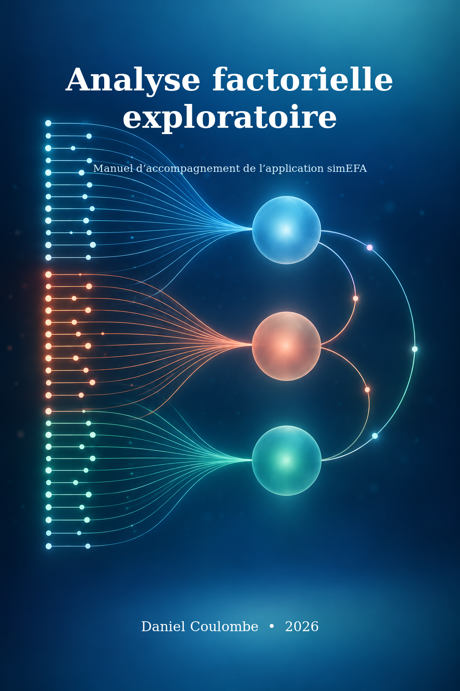

::: {.content-visible when-format="html"}

{fig-align="center" width="72%"}

:::

# Préface {.unnumbered}

Ce manuel accompagne [**simEFA**](https://shiny.dcstats.org/simEFA), une application conçue pour apprendre à raisonner avec une analyse factorielle exploratoire (AFE). L’application rend les choix visibles et manipulables; le manuel explique pourquoi ces choix existent, ce qu’ils permettent d’apprendre et ce qu’ils ne permettent pas de conclure.

::: {.callout-note title="Application compagnon"}
Les activités proposées dans ce manuel se réalisent dans [**simEFA**](https://shiny.dcstats.org/simEFA). Ouvrez l’application dans un autre onglet : le manuel indique précisément quels réglages modifier et quels résultats lire.
:::

L’AFE sert à étudier une question simple en apparence : plusieurs réponses observées semblent-elles refléter un plus petit nombre de construits communs? Elle n’est pas une machine à « découvrir la vérité ». Elle met en relation une théorie, des items, un échantillon et des décisions analytiques. Les facteurs proposés doivent toujours être interprétés à partir du contenu des items, puis confrontés à de nouvelles données.

L’application accepte des fichiers CSV, Excel, SPSS et Stata. Elle comprend également un laboratoire de simulation, huit jeux de données réels, une analyse parallèle, les rotations Varimax et Oblimin, des diagnostics d’interprétation, la fiabilité des sous-échelles, un bootstrap et une étape de validation CFA sur un nouvel échantillon simulé. Ce manuel privilégie une démarche sobre : faire peu de choses, mais savoir ce qu’elles signifient.

::: {.callout-tip title="À la fin du parcours"}

- vous saurez distinguer une composante principale d’un facteur latent, et écrire le modèle qui relie les items aux facteurs;
- vous saurez préparer une matrice d’items pour une AFE et justifier le nombre de facteurs retenu;
- vous pourrez lire des charges standardisées, des charges croisées et des communalités sans appliquer de seuil mécanique;
- vous comprendrez le rôle de l’extraction, de la rotation, de la fiabilité et du bootstrap;
- vous saurez transformer une solution exploratoire en modèle CFA candidat, à vérifier sur de nouvelles données;
- vous saurez rédiger un compte rendu qui expose les décisions autant que les résultats.
:::

## Le parcours proposé {.unnumbered}

| Chapitre | Question | Où dans simEFA |
|:--|:--|:--|
| 1. Comprendre ce que cherche une AFE | Que modélise une AFE, et en quoi diffère-t-elle d’une ACP? | **Données simulées**, **Aperçu des données** |
| 2. Préparer et examiner les données | Les items sont-ils prêts à être analysés ensemble? | **Préparation des items**, **Aperçu des données**, **Tests préliminaires** |
| 3. Décider du nombre de facteurs | Combien de facteurs les données soutiennent-elles? | **Tests préliminaires**, **Comparaison des modèles** |
| 4. Extraire et tourner une solution | Comment estimer, puis orienter la solution? | **Paramètres de l’analyse**, **Interprétation ▸ 3. Facteurs corrélés** |
| 5. Interpréter la solution factorielle | Que mesurent les facteurs, et quels items posent problème? | **Interprétation** |
| 6. Stabilité, fiabilité et prudence | La solution tient-elle à l’échantillon? | **Fiabilité des facteurs**, **Bootstrap** |
| 7. De l’AFE à la validation CFA | La structure se retrouve-t-elle dans de nouvelles données? | **Validation CFA** |
| 8. Laboratoire guidé | Le parcours complet, de la simulation à la CFA | tous les onglets |
| 9. Glossaire · 10. Canevas de rapport | Les mots justes, puis le compte rendu | — |

: Les chapitres du manuel et les écrans de simEFA. {#tbl-parcours}

Chacun des sept premiers chapitres s’ouvre sur ses objectifs et son idée centrale, alterne explications, figures et encadrés **Dans simEFA**, puis se termine par un **laboratoire** (avec sa réponse repliée), un résumé et un court quiz. Les figures qui ne sont pas des captures d’écran ont été calculées pour ce manuel avec les mêmes fonctions que l’application.

## Le cas fil rouge {.unnumbered}

::: {.callout-note title="Cas fil rouge"}
Au démarrage, simEFA propose le laboratoire de simulation avec la situation **Structure claire** : 300 personnes, deux facteurs corrélés à 0,30, quatre items par facteur, charges principales de 0,70, **graine 1234**. Il suffit de cliquer sur **Générer**. Sauf mention contraire, les captures d’écran et les nombres cités dans le manuel proviennent de cet échantillon. Comme la population est connue, on peut toujours comparer ce que l’AFE retrouve à ce qui a réellement été généré.
:::

Le fil rouge est complété par des données réelles fournies dans l’application (**Données classiques**) : l’échelle d’estime de soi de Rosenberg pour la préparation des items, les tests d’Holzinger et Swineford pour une structure classique à trois facteurs, et l’inventaire BFI pour des données avec valeurs manquantes.

## Comment travailler {.unnumbered}

Commencez avec les données simulées, surtout si l’AFE est nouvelle pour vous. La population génératrice est alors contrôlée : vous pouvez modifier une seule difficulté à la fois (corrélation entre facteurs, charges croisées, taille d’échantillon ou bruit) et observer les conséquences. Gardez la même graine pendant ces comparaisons : seul le réglage modifié change alors. Passez ensuite à un jeu classique ou à vos propres données.

::: {.callout-important title="Un principe directeur"}
Une solution factorielle ne se juge jamais par un seul nombre. Le nombre de facteurs, les charges, les communalités, les corrélations entre facteurs, le contenu des items et la réplication doivent raconter une histoire compatible.
:::
